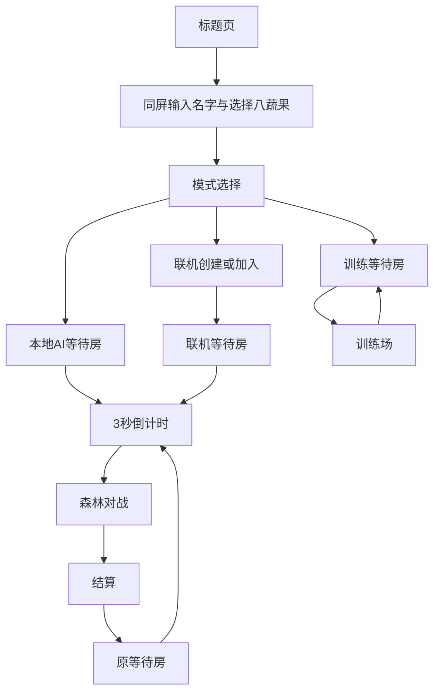
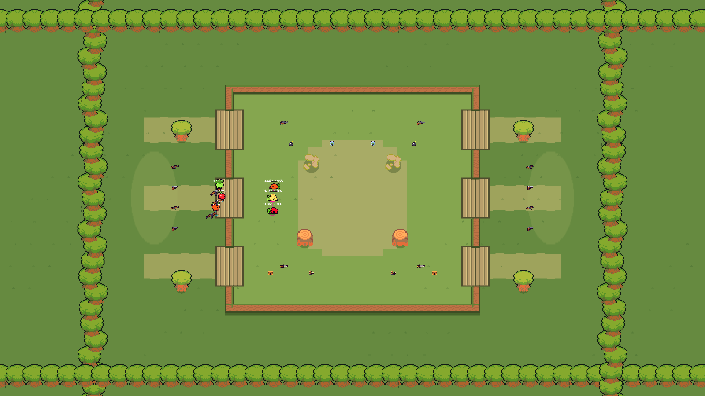
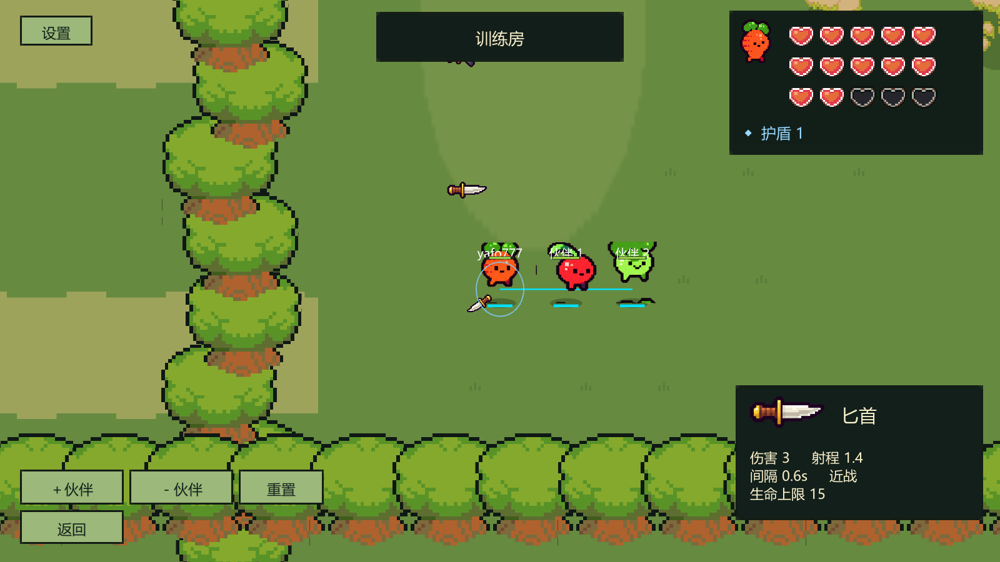

# Bound Shoot《绳紧兵大作战》完整游戏策划案

版本：整合策划 v1.0 · 日期：2026-11-01 · 源码基线：6a86ea6及本机当前工作区。

用途：供玩法、关卡、程序、美术和测试共同执行。本文统一当前规则，并给出下一阶段设计与验收要求；不是全部功能已经通过验收的声明。配套证据见 [项目完整分析](PROJECT_AUDIT_2026-11-01.md)。

## 阅读与决策约定

- **现行**：最新用户约定与当前实现一致的规则，后续开发必须保持。
- **实现现状**：源码可见行为，不代表已完成跨机器或真人验收。
- **建议**：本策划提出的改进、指标或生产方案，尚不构成改代码、改数值、构建或部署授权。
- **待决策**：需要玩法试验后再确定，不写成已经确认的产品承诺。

规则优先级：最新用户修正 ＞ 森林v3及其后续修正 ＞ 蔬果v1.1 ＞ 旧原型文档。当前生命值已是9/3/9/9/15，禁止再次乘3。复活区、死亡前锁枪、鼠标前瞻镜头、赛博火柴人主风格均不再作为当前设计。

## 目录

1. 产品定位与设计支柱
2. 核心循环与单局体验
3. 模式、人数与产品边界
4. 完整页面和交互流程
5. 角色与操作
6. 武器、伤害及换枪
7. 道具与资源
8. 绳索与团队协作
9. 死亡、复活与胜负
10. 地图与关卡设计
11. AI与训练
12. HUD、镜头与可读性
13. 美术、动画与声音
14. 联机、身份与异常处理
15. 战绩与长期内容边界
16. 数值分析与平衡试验
17. 配置与制作流程
18. 测试与验收
19. 里程碑、任务和职责
20. 风险、待决策与交付边界

## 1. 产品定位与设计支柱

**一句话定义：八种蔬果拿起武器，被绳索连成小队，在森林高台中合作走位、拖动伙伴，并争取在敌人复活前完成团灭的俯视2D派对射击游戏。**

| 项目 | 定义 |
|---|---|
| 当前主平台 | Windows键鼠；开发体验以Unity Editor、本地主机和局域网为主 |
| 游戏类型 | 实时小队竞技、轻操作射击、物理协作 |
| 默认规模 | 2v2；等待房支持3v3、4v4 |
| 单局时间 | 最长180秒，另含3秒开局倒计时与房间时间 |
| 受众假设 | 愿意与朋友语音配合、接受短局反复尝试的休闲竞技玩家；尚无用户调研结论 |
| 核心乐趣 | 一起走、互相拉、共同进退、短时间集火形成团灭 |
| 视觉定位 | 高辨识蔬果、大枪、低噪声像素森林、清楚的台阶与高台 |
| 当前范围外 | 搜打撤、背包经济、随机词条装备、永久战力成长、占点胜负、跳跃平台、开放世界 |

设计支柱：

1. **个人动作简单，团队选择有意义。** WASD、鼠标、E即可覆盖主要操作；绳索与座位提供合作深度。
2. **拉扯可预期。** 玩家能看见绳子绕哪一侧、谁在牵引，撞墙和回拉符合场景轮廓。
3. **倒地仍属于队伍。** 身体保留绳链；存活队友争取五秒并改善起身位置，而非前往固定救援站。
4. **信息优先于装饰。** 危险、生命、伙伴状态和拾取反馈必须在混战中可辨。
5. **先完成一局，再扩内容。** 三种模式共享规则；本地体验和联网兼容分别验收。

本作暂不需要长篇背景故事。可使用“森林里蔬果小队参加绳结竞技”的轻设定作为包装建议，不为角色添加未经确认的技能或种族属性。

## 2. 核心循环与单局体验

短循环：观察伙伴及敌人 → 沿可通行路径共同移动 → 拾取或切换武器 → 对枪/绕障/使用道具 → 拖动倒地伙伴并争取时间 → 复活再组织或完成团灭。

长循环：进入等待房 → 选择人数与座位 → 对战 → 看结算 → 调整座位和战术 → 再战。当前没有局外养成循环。

| 阶段 | 玩家任务 | 设计目的 |
|---|---|---|
| 出生准备 | 空手9血，寻找首枪，适应绳长 | 让队员自然汇合，避免出生即被迫远程对枪 |
| 接近中央 | 选择上/中/下台阶路线 | 共同决定交火位置，理解链条转弯 |
| 交火争夺 | 利用掩体、枪械射程与绳索道具 | 让火力和队形共同决定优势 |
| 倒地窗口 | 进攻方追击剩余活人；防守方争取五秒 | 给短时集火和掩护明确目标 |
| 终局 | 团灭结束，或180秒比较存活与生命 | 保持短局竞技，不引入击杀积分取胜 |
| 复盘 | 看击杀、倒地、伤害并再次开局 | 支持快速试验策略，不把结算变成复杂报表 |

拖尸的意义已经改变：当前拖动是调整复活地点、避开敌人火线或维持链条通路，不是完成“拉到复活点”的任务。

## 3. 模式、人数与产品边界

| 模式 | 参与者与开局 | 结束规则 | 当前状态 |
|---|---|---|---|
| 训练房 | 本人＋0–3静止伙伴，训练预设为本人＋1/2/3伙伴与2/3/4靶子 | 无正式180秒胜负；手动重置/离开 | 已有实现 |
| 本地AI对战 | 本人自动入座，其他席位补AI | 与正式竞技相同 | 已有实现 |
| 局域网对战 | 房主创建，朋友填地址加入；默认等真人，房主可补AI | 与正式竞技相同 | 已有Host/Client实现；跨机待验收 |
| 未来公网对战 | 简洁房间入口，Node业务服务＋独立权威战斗服务器 | 统一战斗与持久化结果 | 目标；云端旧版本不代表当前策划 |

人数决定每队链条：2人1段、3人2段、4人3段；双方总计2/4/6段。只连接相邻座位，不闭环，也不将所有队员两两连接。

当前“本地”指本机权威Host或单人训练，不代表分屏、共享键盘双人或手柄多人。上述功能未纳入范围。

## 4. 完整页面和交互流程



| 页面 | 必需内容 | 操作与状态规则 |
|---|---|---|
| 标题 | 游戏名、进入、设置、退出 | 不显示版本标语、服务器地址或开发说明 |
| 身份 | 名字输入、大头像、4×2角色卡、确认/返回 | 1–24字中文/英文/数字/下划线；角色可重复；错误靠近输入框 |
| 模式 | 训练、本地AI、联机三张入口 | 本人头像/名字可见，允许回身份修改 |
| 联机次级页 | 创建、房主地址、加入、返回 | 地址仅属于当前LAN调试入口；未来公网不要求玩家填IP |
| 等待房 | 两队座位、链条关系、人数、开始、离开 | 本人位置突出；空位、真人、AI明确区分 |
| 对战 | 必要HUD、设置、离开 | 不把配置、日志、测试指引放进战斗画面 |
| 结算 | 胜负、两队名单、击杀/倒地/伤害、再来/返回 | 房主重开；其他人等待状态应可辨 |

房间现行规则：房主调整人数和开始；所有启用位置有参与者才可开始，不增加准备按钮。真人开局前替换AI，战斗中不新增真人。只能移动到空位/AI位，已有人位置不被抢占。缩小人数若会移除真人，拒绝并要求先换位。连接正在分配座位时不重排。

界面补齐建议：连接中提供超时后的重试/返回；重复点击只发起一次操作；房主退出明确返回模式页；缩容失败给“请先调整超出人数的位置”。当前LAN补AI是整房补齐，逐席开关属于后续建议，不冒充已有功能。

## 5. 角色与操作

八个现有身份：**红根、番茄、西兰花、茄子、草莓、洋葱、胡萝卜、蓝帽菇**。八者无属性或技能差异，允许双方重复选择。队伍识别依靠队色、脚标和名字，不能依赖角色本色。

| 输入 | 功能 |
|---|---|
| WASD | 平面移动，斜向归一化 |
| 鼠标 | 独立瞄准 |
| 左键 | 持续尝试攻击，受武器冷却约束；空手不能攻击 |
| E | 消耗当前携带道具 |
| 踩到武器/道具 | 满足拾取条件即生效，无背包确认页 |
| ESC | 设置面板，阻止本地战斗输入；不暂停联网比赛 |

身体根据实际位移选择上/下/侧向行走，左向镜像侧向，静止保留最后朝向；绳索拖动也产生行走反馈。枪独立跟随瞄准，不随身体转向锁死。当前使用六帧、12fps步行循环；被拖动是否需要独立“滑步”动画仅作后续表现建议，不改变位移驱动的要求。

## 6. 武器、伤害及换枪

以下数值直接取当前GameConfig，单位为世界单位、秒、HP；不是本案新增调参。

| 武器 | 生命上限 | 单次伤害 | 射程 | 攻击间隔 | 弹速 | 定位 |
|---|---:|---:|---:|---:|---:|---|
| 空手 | 9 | — | — | — | — | 出生/复活状态，必须找枪 |
| 狙击枪 | 3 | 4 | 100 | 1.4 | 40 | 长距离高单发伤害，低生命风险 |
| 手枪 | 9 | 1 | 7 | 0.45 | 20 | 短程基础枪，当前竞争力需验证 |
| AK | 9 | 2 | 15 | 0.22 | 24 | 持续压制，当前纸面优势明显 |
| 匕首 | 15 | 3 | 1.4 | 0.6 | — | 近身范围攻击，高生命上限 |

现行规则：

- 活着且靠近不同武器时自动换枪；同种武器不重复消耗拾取点。
- 当前HP变为 `min(原HP, 新生命上限)`，不按比例换算，不填满新上限。
- 换枪不清空旧冷却，并至少等待新武器的攻击间隔；不能用踩枪刷连射。
- 同一物理步每名角色最多换一把枪；抢拾取按距离优先，同距以稳定身份顺序裁定，不以客户端画面先后为准。
- 拾取半径0.75；被拾取武器等待该点配置的刷新时间。刷新为0表示一次性。
- 没有弹药、换弹、弹夹、穿透、暴击或爆头系统，不额外添加相应HUD。
- 无默认友伤。护盾先吸收，剩余伤害扣生命；伤害统计按实际消耗生命及盾计算。
- 弹丸由服务器扫掠判定墙和敌人；近战需满足距离、朝向和无遮挡，可命中符合条件的多个敌人。

设计实例：9血拿匕首仍是9/15；9血拿狙击变3/3，再拿AK为3/9。玩家主动选择狙击时确实放弃了生命，必须通过红/灰心变化和三秒拾枪卡清楚表达。若后续要改变这一规则，应作为独立玩法变更，不通过UI偷偷补血。

## 7. 道具与资源

| 道具 | 获取/作用对象 | 现行效果 | 终止/覆盖 |
|---|---|---|---|
| 绳索收缩 | 拾取立即，对敌队 | 每段绳长×0.65，10秒 | 再拾刷新持续时间，不永久累乘 |
| 绳索延长 | 拾取立即，对本队 | 每段绳长×1.5，10秒 | 再拾刷新时间 |
| 护盾 | 拾取立即，对本人 | 加1盾，上限1 | 伤害先扣盾，死亡清空 |
| 冲刺装置 | 进入E单槽 | 沿移动方向，无移动则沿瞄准；速度14、持续0.18秒 | 使用一次消耗；受碰撞和绳索影响 |
| 炸弹 | 进入E单槽 | 原地放置，3秒后爆炸，半径2.5，敌方伤害2，检查遮挡 | 使用后槽清空，爆炸物由世界管理 |
| 弹性强化 | 拾取立即，对双方绳索 | 弹簧和最大力×3，10秒；当前阻尼不同比例放大 | 刷新时间，不永久累乘 |
| 血包 | 拾取立即，对本人 | 回复1HP，不超过当前上限 | 即时完成 |
| 问号盒 | 拾取时解析 | 从启用且正权重的七种道具抽取；当前各权重1 | 状态立即生效，携带类覆盖E槽 |

同一队同时被收缩并获得延长时：`5 × 0.65 × 1.5 = 4.875`单位。状态持续在队伍/世界层，不因一名队员死亡而自动取消；重开清空。

携带槽只有一个：炸弹和冲刺互相覆盖；不弹出二选一窗口。现实现满血/满盾仍可消耗相应拾取物，收益为0；建议用短反馈避免误以为成功加血，是否保留地面资源供队友拿须单独决策。

资源是局内争夺对象，不进入局外背包或结算奖励库。地面资源需分清可拾取、刷新中、一次性已用三种状态；刷新进度环为建议表现。

## 8. 绳索与团队协作

现行基础参数：长度5、弹簧90、阻尼12、最大力200。活人和倒地身体质量均为1；静止制动力低于主动移动，使队友确实能被牵引。

实际绳索使用每段独立的连续路径状态RopeRoute。角色经过障碍时保留绕行侧，只有满足安全退绕条件才删折点；不能每帧重新选全局最短路径。AI寻路仍可求最短路，这与绳索的历史路径是不同职责。

| 绳索状态 | 玩家应看懂 | 行为要求 |
|---|---|---|
| 松弛 | 仍有自由移动空间 | 不产生无理由的持续拉扯 |
| 拉紧 | 继续分离将拖动伙伴 | 张力与端点方向清楚，受力沿最近折点 |
| 绕障 | 链条经过树石/崖壁哪一侧 | 不穿墙、不同帧不突然换边 |
| 倒地 | 此身体仍连在队伍里 | 可拖动、可绕障，五秒后当前位置起身 |
| 状态道具生效 | 影响哪队、何时恢复 | 与实际长度/弹性同步，不能只改变线颜色 |

2v2适合教学和主要平衡基线；3v3中间位承受两侧拉力；4v4更依赖转弯顺序和路线宽度。座位是战术关系，不额外命名成有属性差异的职业。

建议重点测试：相邻队友反向走、两段绕不同障碍、中间位倒地、带尸体上台阶、冲刺撞角、收缩与延长同时到期。禁止以传送队友脱困掩盖路径错误。软约束允许短暂伸长，不承诺任何时刻长度绝不超过5。

## 9. 死亡、复活与胜负

### 9.1 权威顺序

1. HP归零：记一次倒地与致命来源击杀，清武器、携带道具、护盾和冲刺；保留身体、座位、绳链。
2. 倒地者不能操作、攻击、拾取；个人五秒计时开始。
3. 同一物理步处理伤害后先检查团灭和回合时间，再处理允许的复活。
4. 队内尚有活人且比赛未结束，倒地满5秒在身体当前位置复活；已连接角色才参与正常复活处理。
5. 复活为空手9HP、0盾、空道具槽，给予2秒保护；实际主动攻击提前结束保护。
6. 结算与重开清空待复活状态，不在结果页继续起身。

例如：A在第10秒倒地，应在第15秒复活；B作为最后活人第14.9秒倒地，该队立即失败，不能等A计时结束。若A身体被拖到台阶上，第15秒在台阶当前位置起身，不回出生点。

安全位置恢复属于待补充防御策略：如未来移动平台或编辑错误导致身体位置非法，应在同一可行走面寻找最近合法点；当前不宣称已有完整安全投影系统。

### 9.2 胜负

| 条件 | 判定 |
|---|---|
| 一队全灭 | 另一队胜 |
| 双方同一物理步全灭 | 平局 |
| 到达180秒 | 先比较存活人数，多者胜 |
| 存活数相同 | 比较存活者当前HP总和，多者胜，不含盾 |
| 仍相同 | 平局 |

击杀数、累计伤害不参与胜负计算。训练不执行正式团灭与计时结算，靶子倒地2秒后回靶位，是训练专属例外。

## 10. 地图与关卡设计

主地图为 **Forest_01／林间高台**：战斗边界72×48，中央高台36×32，两侧低地。左右各三处台阶，中心Y为−10、0、10，标称宽6。左右队员出生X约−29/+29；地图外部树林用于视觉延伸，不增加可行走区域。

```text
                          北侧森林
        左上台阶 ─── 高台北线／狙击点 ─── 右上台阶
            │                  │                  │
 蓝低地与首枪 ─ 左中台阶 ─ 中央对枪区 ─ 右中台阶 ─ 红低地与首枪
            │                  │                  │
        左下台阶 ─── 高台南线／近战点 ─── 右下台阶
                          南侧森林
```

高台采用俯视2D规则：不做桥上/桥下同XY重叠；崖壁阻挡身体、弹丸、爆炸视线和绳索，台阶缺口可通行。高度本身不提供伤害、射程或免伤加成，没有跳崖、攀爬、落下伤害。

当前资源布局：

| 区域 | 每侧内容 | 刷新 |
|---|---|---|
| 低地X±26 | 四个首枪点，手枪/AK交替，Y约−4.5/−1.5/1.5/4.5 | 8秒 |
| 高台北侧X±10，Y11 | 狙击枪 | 12秒 |
| 高台南侧X±10，Y−10 | 匕首 | 10秒 |
| 高台内部镜像点 | 护盾、冲刺、炸弹、问号盒各一 | 12秒 |

总计20个显式拾取点。收缩、延长、弹性、血包在主图没有对应固定点，主要通过问号盒获得；训练提供完整种类。不要把“七道具已实现”误写成主图有七种固定道具点。

其他地图：Arena_01（32×24）与Field_01（80×64）保留在配置并标为available；当前本地入口固定选森林，不等于已有面向玩家的三地图选择流程。训练地图由独立工厂生成。

关卡制作要求：

- 左右资源价值与首枪到达距离对等；换边试玩排除队伍偏差。
- 台阶视觉开口与实际blocks缺口一致；不能只改plateau尺寸却保留旧碰撞。
- 首枪区避免被跨屏长直线直接压制；中央提供至少两种接近路线。
- 每处关键拐弯检查4人链实际通过，而不只检查单角色能走。
- 复活后附近有可争夺的再武装路线；不得新增复活区作为解决方案。
- 初期共用同一主地形，按2/3/4人数记录拥挤与资源缺口，再决定是否做模式专属预设。

## 11. AI与训练

当前AI在权威端执行，使用正常武器与伤害；约0.25秒选目标、0.35秒更新路径，使用简单提前瞄准和误差。主要行为是找枪、接近敌人、按武器距离开火、照顾相邻真人位置和有条件使用携带道具。

当前尚不能视为成熟战术AI：没有完整基于持续绳路张力的团队规划，也没有围绕五秒复活窗口的撤退/守位战术。建议依次补：

1. 无进展检测与原侧退绕，禁止传送脱困。
2. 相邻两段绳张力成本，减少中间位被两头拉。
3. 最后存活者优先保命至伙伴起身，同时考虑复活附近的武器资源。
4. 集火和不同难度反应参数；不通过额外血量、射程或穿墙作弊制造难度。

训练体验按四个可自由尝试的区域组织：四武器靶场、道具样品区、两人绕障拖拽区、台阶与多段链演练区。前三者可利用现有训练实现，训练专属台阶课程为建议增量。只用必要图标/操作按钮，不常驻课程长文。

训练验收：能增加/减少最多3名无自主AI伙伴，reset恢复资源和状态；伙伴可被拖动；靶子2秒回靶位；退出后能进入正式本地AI对局，网络对象不残留。

## 12. HUD、镜头与可读性

| 位置 | 现行/目标信息 | 状态 |
|---|---|---|
| 右上 | 本人头像、红/灰心、独立盾、倒地计时 | 已实现；每行5心，15血三行完整显示 |
| 顶部中央 | 时间、双方存活数、3/2/1倒计时 | 已实现；人数不能让玩家误认为击杀比分 |
| 右下 | 换枪后的武器数值卡 | 已实现；只显示3秒，同枪不续时、换枪重新计时 |
| 右下独立小栏 | E道具图与名称 | 已实现；不随枪卡隐藏 |
| 左上/边缘 | 队伍Buff到期反馈、屏外伙伴方向及倒地状态 | 完整反馈体系为待补齐建议 |
| 角色附近 | 队标、简名、命中/倒地反馈 | 保持简洁，避免名字互压 |

枪卡展示图、名称、伤害、射程、攻击间隔、弹速或近战、生命上限；使用非缩放时间计3秒。死亡或离开清除，HUD重绘不能刷新展示时长。

镜头严格跟本地角色主体锚点（当前位置上方0.25单位）；包括被拖动和倒地。禁用鼠标前瞻、滞后跟随、边界钳制偏心和镜头震动；冲击感由枪械后坐、局部特效及声音承担。不能为了显示队友而自动缩小到角色难以辨认。

建议验收分辨率：1280×720、1600×900、1920×1080以及16:10。屏外伙伴箭头、颜色＋形状双重队标、独立音乐/音效音量为改进目标；当前设置主要是音效开关，不能写成已具备完整设置页。

## 13. 美术、动画与声音

视觉方向沿用蔬果和森林，不再回到赛博风格。角色高饱和，背景低对比；大枪保留清楚枪口和握点，尽量不遮脸；树冠可淡出，实际阻挡由树干/石块底座表达。

已查看的历史视觉材料：





以上为2026-10-30仓库存档的Unity渲染截图，站位/血量由审查脚本安排；不是本次运行或真人体验证明。地图骨架和红心层级可读，重复树墙、草土过渡与小角色名字拥挤仍可继续打磨。

| 资产组 | 保留基线 | 后续补齐建议 |
|---|---|---|
| 八角色 | 现有身份、前/后/侧动作与移动朝向 | 受击、倒地、复活一致性；小尺寸轮廓检查 |
| 四武器 | 独立瞄准、统一枪口、开火归属 | 不同武器攻击节奏/音色，近战范围反馈 |
| 绳索 | 连续路线、张力、拐点表现 | 短/长/弹性效果与到期可读性 |
| 森林 | 草土、树冠、石头、崖壁、台阶 | 减少重复感但不增加主战区噪声 |
| 道具 | 地面图、E槽图、基础特效 | 生效对象、盾破、无收益拾取、炸弹临爆反馈 |
| UI | 居中卡片、头像、红心、三秒枪卡 | 键盘焦点、按钮状态、等待/错误/断线反馈 |

制作流程建议：先通过“一个角色＋一枪＋一组障碍＋一段绳索”的游戏内样板，再扩全量；固定画布、脚底锚点、握点、像素密度与调色。旧资产保留档案，不混进当前主风格。

环境资源的来源、作者和许可记录沿用FOREST_V3_ASSETS.md，本策划未重新审核外部许可。蔬果与枪械按各自manifest管理，不因环境包来源明确就宣称所有资产同源。

声音优先级建议：炸弹临爆/受击危险 ＞ 盾破/倒地 ＞ 本人攻击 ＞ 附近其他攻击 ＞ 绳索/脚步/环境。最小清单包括四武器、拾枪、治疗、盾破、绳拉紧、冲刺、炸弹、复活、胜负和UI。当前合成音作基线，不能宣称已完成正式配乐和混音。

## 14. 联机、身份与异常处理

当前训练和本地AI不依赖Node；LAN由Unity Host权威运行，UDP7779是当前默认端口。主机退出即中止本地房间，没有房主迁移。LAN中其他真人掉线后转AI，战斗中不接受重新插入真人；这与旧独立服务器的20秒原实体重连不是同一功能。

未来公网仍采用NGO＋Unity独立权威服，Node管身份、房间、票据与战绩。当前云端保持旧版；源码后端skin已支持0–7，但快捷模式仍固定2v2，不能只看角色范围就认定与本地新流程兼容。

| 场景 | 当前边界 | 产品要求/建议 |
|---|---|---|
| LAN房满/名字非法/开局后加入 | 接入拒绝 | 给可操作的错误与返回，不留半初始化界面 |
| 等待房真人掉线 | 空位或AI状态由补位模式决定 | 所有端一致显示，占位及时释放 |
| LAN战斗真人掉线 | 转AI，不提供同身份战中夺回 | 首版明确保持此规则；重连若要支持另立需求 |
| LAN房主退出 | 房间中止 | 客户端结束等待并可回模式页 |
| 公网旧服失联 | 有心跳/超时/中止框架 | 重做新版兼容和结算故障测试后再启用 |
| 配置/协议不一致 | 缺少完整显式内容握手 | 建议接入前校验protocolVersion、contentHash、mapId和人数 |

名字是显示身份，不能作为所有权凭证。未来公网恢复角色必须靠会话/短期票据，而不是重复输入同名。正式玩家入口最终是公网IP/HTTPS域名，玩家不需要Bitvise、SSH或隧道。

发布前须解决结算重试停止心跳与后端20秒清理的时序冲突。它属于独立服链路，不应据此认定当前本地结算依赖Node。

## 15. 战绩与长期内容边界

当前局内结算保留击杀、倒地、有效伤害与队伍胜负。LAN结果在当前会话展示；不要承诺本地局自动上传云端或跨设备保存。

Node已有比赛及账号累计数据模型，供未来统一公网版本使用。训练不写竞技成绩；重复结算不能重复加分；异常中止不计正常胜负。AI与真人在分析数据中需能区分。

长期内容建议优先顺序：同规则地图变化 → 玩法可读性与训练 → 可选外观。当前不新增排位、赛季、商城、通行证或属性成长。商业模式与售价暂不定义，避免把未研究的发行方案写成产品事实。

## 16. 数值分析与平衡试验

### 16.1 现有纸面对比

面对9HP、无护盾、无保护、全部命中的目标，首发时刻记为0，不计换枪等待、飞行、距离和走位：

| 武器 | 击倒所需命中 | 首次至最后一次攻击的最短间隔 |
|---|---:|---:|
| 狙击枪 | 3 | 2.80秒 |
| 手枪 | 9 | 3.60秒 |
| AK | 5 | 0.88秒 |
| 匕首 | 3 | 1.20秒 |

公式为 `ceil(HP/伤害)` 与 `(命中次数−1)×攻击间隔`。这是源码数值推导，不是实测击杀时间或胜率。

主要设计问题：

1. AK与手枪同为9上限，AK的伤害、射程、间隔和弹速均占优。除资源可得性外，尚缺明显选择手枪的收益。先记录拾枪选择和有效命中，再试验资源稀缺度或一项武器参数，不同时改整套数值。
2. 匕首15是上限而非换枪即得生命。出生9血拿匕首要六次+1治疗才满，而主图没有固定血包；其耐久定位可能很难体现。
3. 自动复活9血但空手，首枪刷新8秒、复活5秒可能产生再武装空窗。必须记录复活后首次拿枪时间，不能只统计“复活成功”。
4. 狙击射程100超过森林宽72，但受墙和个人视野限制；不改变严格居中镜头来偷偷提供瞄准优势。
5. 护盾1与血包1在新生命尺度下相对价值下降，炸弹2伤同样需要验证。不能未经确认再把道具统一乘3。
6. 五秒回场加上高血量可能提高超时比例；4v4只要最后一人坚持即可持续复活。先看追击路线和集火能力，不默认添加缩圈或复活次数上限。

### 16.2 建议试玩目标（待用真实样本校准）

| 指标 | 首轮试验目标或用途 |
|---|---|
| 新手进入AI首局 | 5人中至少4人无需口头指导进入并开战 |
| 首枪时间 | 中位数约1–4秒；超出重点检查出生、资源与绳索 |
| 首次有效交火 | 中位数约8–20秒，分别统计2/3/4人数 |
| 复活后再武装 | 记录中位数与P90，连续空手挨打超过5秒的情况逐个复盘 |
| 团灭/计时比例 | 先统计；若多数样本跑满180秒且反馈消极，再调整节奏 |
| 卡绳 | 合法通路上不得出现只能重开解决的永久卡死 |
| 再玩意愿 | 访谈是否愿意再开与原因，不把5人小样本当市场验证 |

每局记录人数、地图、配置摘要、AI占比、换边、首枪/首战/复活拿枪时间、终局原因、伤害来源、绳索卡点。先收集至少20局节奏样本；平衡比较应换边、区分新手与熟练玩家，并说明样本不足。

## 17. 配置与制作流程

| 数据/模块 | 来源 | 负责方向 |
|---|---|---|
| 武器/道具/基础规则 | Resources/GameConfig.json | 策划数值；程序负责规则实现 |
| 地图点位和障碍 | 同配置＋Level Editor | 关卡设计；导出检查和冲突保护 |
| 森林初始模板 | ForestMap.cs | 程序模板，不能与策划保存的地图互相覆盖 |
| 训练地图 | TrainingMap.cs | 训练用布局与完整道具覆盖 |
| 角色与武器显示 | VegetableArt、CyberPlayerView、WeaponPresentation | 美术与程序共同维护身份/挂点 |
| 结算与权威规则 | BattleWorld、NetPlayer | 程序与测试 |
| 本地/远端接入 | LocalMatchRuntime／ServerRuntime＋backend | 程序；区分两条链路验收 |

关卡闭环：选图 → 摆放 → 检查边界/重叠/可达性 → 保存 → 停止并重新Play → 录制相同路径 → 修正。当前编辑器已能保留最新数值并检测同图冲突；路径可达性、镜像资源统计、多人链通行等检查须按工具实际能力区分自动与人工。

每次平衡变更保存：旧值、新值、目的、预期影响、测试配置摘要、样本和结论。当前本机Unity版本文件有用户修改，策划编写不覆盖它；测试环境版本需写入报告。

## 18. 测试与验收

| 编号 | 场景 | 通过标准 |
|---|---|---|
| QA01 | 标题→身份→三模式 | 中文/最长名/非法字符处理正确，返回不丢失已确认身份 |
| QA02 | 2v2/3v3/4v4等待 | 座位与链段数正确；等待90秒仍能开始；缩容不踢真人 |
| QA03 | 同时加入/抢AI位 | 所有端唯一占位，开局固定名单，未出现重复所有权 |
| QA04 | 四武器换枪 | 不回血，不刷冷却，同枪不消费；9→狙击→AK为9→3→3 |
| QA05 | 红心与拾枪卡 | 3/9/15上限完整；每行5颗；枪卡真实3秒隐藏，E槽独立 |
| QA06 | 八角色×四方向 | 身体依移动、枪依瞄准；拖动和停步无方向跳变 |
| QA07 | 七道具＋问号盒 | 目标队伍、持续、覆盖、死亡、到期和重开完全一致 |
| QA08 | 五秒复活 | 身体当前位置回场；全灭/超时优先；9血空手；攻击解除保护 |
| QA09 | 绳索绕角与台阶 | 连续路径不跳边穿墙；退绕可解；中间位倒地仍能合理移动 |
| QA10 | 子弹/大枪贴墙 | 不越墙出生、不漏枪口前敌人、归属正确、远端显示连续 |
| QA11 | 结算与20局重开 | 结果一致，无上一局弹丸、Buff、复活和统计残留 |
| QA12 | LAN中途离开 | 客户端离开转AI；房主退出其他端可恢复到菜单 |
| QA13 | 弱网/跨机 | 分层验证，记录RTT、丢包、位置修正和输入延迟，不以同进程替代 |
| QA14 | 8人压力5分钟＋连续往返30分钟 | 记录帧耗时、GC、内存、网络量，无持续增长和未处理异常 |
| QA15 | 不同屏幕与设置 | 必需按钮可达、15心完整、主体锚点居中误差不超过1显示像素 |
| QA16 | 未来独立服结果故障 | 延迟/重试/响应丢失/服务重启均不重复入账，异常不会冒充正常胜负 |

性能目标建议为目标测试PC上1080p稳定60fps、30Hz权威逻辑；尚未定义最低硬件，也未做本次性能测试，不作为已达标结论。弱网首轮建议0/50/100/150ms RTT与0/1/3%丢包组合，工具设置与实测值同时保存。

证据层级必须独立：静态检查、规则单测、PlayMode、多NetworkManager真实UDP、跨进程、跨机器、云端、真人手感。截图只证明对应画面，不证明操作、物理或比赛自然完成。

## 19. 里程碑、任务和职责

以下为建议执行顺序，不自动启动实现，也不承诺未经估算的日期。

| 阶段 | 主要交付 | 退出条件 | 责任方向 |
|---|---|---|---|
| A 当前版本复验 | 固定源码/内容摘要、更新Unity报告、当前规则清单 | 本地训练/AI三人数回归通过，历史报告差异已说明 | 程序＋测试 |
| B 核心合作体验 | 绳索/台阶/复活再武装样板、最小Buff反馈 | QA04–10通过；真人能解释拉扯与五秒窗口 | 玩法＋程序＋关卡 |
| C 武器与资源试验 | AK/手枪定位、匕首耐久、治疗可得性比较 | 有换边样本与单变量结论，用户确认后才合入数值 | 数值＋关卡 |
| D 完整产品可读性 | UI错误/等待/断线、动作与声音一致性 | 新手流程及720p/1080p检查通过 | UI＋美术＋程序 |
| E LAN候选版 | 跨电脑三人数、长局和弱网记录 | 关键缺陷清零；8真人宣称有8真人证据 | 程序＋测试＋试玩者 |
| F 未来公网整合 | 统一协议/配置、结算可靠性、对应后端/专服 | 用户另行安排构建部署后独立验收 | 网络程序＋用户运维 |

优先任务：A01复验当前三处变化的核心脚本；A02确定本机Unity版本；B01五秒复活同帧边界；B02台阶四人链；B03复活无枪统计；C01AK/手枪与匕首治疗试验；D01Buff与屏外伙伴反馈；E01跨机Host退出/AI接管；F01内容版本握手；F02独立服结算超时修复。

不先铺大量新地图、不新增技能系统、不批量替换全部角色素材。先完成可对比的样板和试玩证据，再估算全量制作。旧产品计划中的人日粗估不直接沿用到当前新规则。

## 20. 风险、待决策与交付边界

| 待决策 | 建议处理 |
|---|---|
| 手枪如何与AK形成选择 | 先验证可得性和命中表现，再比较一项调参，不直接发明新枪技能 |
| 匕首15血上限如何形成实际收益 | 明确维持不回血；试验治疗资源可达性，改规则须另批 |
| 高生命＋五秒复活是否拖长比赛 | 看全灭/超时、复活循环与玩家反馈，不先改成积分赛 |
| 复活后空手是否过于被动 | 首先调资源位置/刷新试验，自动赠枪是规则变更而非默认修复 |
| LAN是否需要战中身份重连 | 当前转AI；若要接管，新增会话凭据与重复连接方案 |
| 满血满盾是否消费拾取 | 当前会消费；团队资源保留策略须实测并单独确认 |
| 首发是否同时承诺三种人数 | 都可本地测试，但只对完成对应真人验收的规模作发布承诺 |

本次策划交付只新增文档与分析证据，不更改游戏代码、地图、生命数值或资产，不运行云端，不构建、不压缩、不自动提交或推送。后续执行按用户选定的任务范围进行。

本案的数据来自本仓库当前源码和文档；没有重新做市场研究、外部素材许可审核或竞品比较，也没有把历史截图当作本次试玩。需要外部发行研究时另立任务，避免把推测填成事实。
