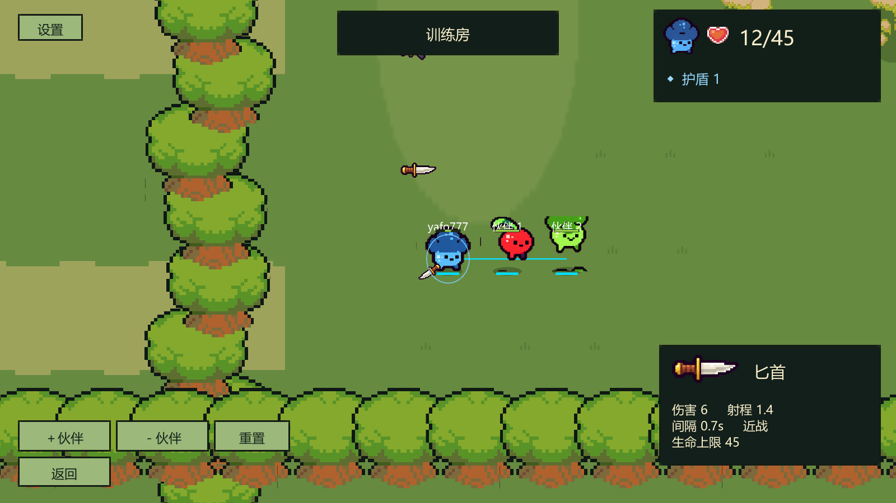

# 道具修改第2条：数字生命与数值编辑器

**后续规则修正：用户要求生命上限与武器无关，现已移除武器生命上限。当前角色上限使用用户设置的100；满血/受伤换枪均不改变生命。下文为当时交付记录，其中武器生命表及相关换枪截断规则已废止，请以[固定角色生命说明](FIXED_CHARACTER_HEALTH.md)为准。**

需求来源：`new needs/道具修改意见.md`第2条。用户已确认本条设计以及下表的耐打初始数值，并在交付后确认进入后续条目。下文保留第2条交付记录；后续功能见[第3条](ITEM_CHANGE_03_FRIENDLY_FIRE.md)和[第4条](ITEM_CHANGE_04_RANDOM_SUPPLIES.md)。

## 已接入的功能

- 战斗右上角用一颗心图标和“当前生命/生命上限”显示血量，护盾单独显示数值。生命上限增大不会再生成大量心形图标；倒地与复活时数字随状态刷新。
- Unity菜单 **Bound Shoot → 数值编辑器**。中文字段可编辑出生/复活生命、回合时长、复活等待和保护时间；四种武器的持有生命上限、单次伤害、攻击间隔、射程、弹速和击退冲量；以及血包、护盾、炸弹参数。
- 保存到 `unity-client/Assets/BoundShoot/Resources/GameConfig.json`，真人、AI和训练共用。运行中的一局不热更新；停止Play、保存、重新Play后生效，即使关闭Domain Reload也会清理配置缓存。
- 匕首也支持击退参数，默认0；狙击默认6。伤害/护盾吸收成功才触发击退，复活保护和关闭的友伤不会触发。
- 换枪不回血：新生命为旧生命与新上限的较小值。出生/复活仍为空手30生命；默认小刀属于尚未实施的第5条。
- 右下拾枪卡仍只在拾取/换枪后显示3秒；E道具继续独立显示。

## 本轮初始数值

| 状态/武器 | 生命上限 | 单次伤害 | 攻击间隔（秒） | 击退冲量 | 射程 | 弹速 |
|---|---:|---:|---:|---:|---:|---:|
| 出生/复活空手 | 30 | — | — | — | — | — |
| 狙击枪 | 18 | 8 | 1.4 | 6 | 100 | 40 |
| 手枪 | 30 | 3 | 0.5 | 0 | 7 | 20 |
| AK | 30 | 2 | 0.25 | 0 | 15 | 24 |
| 匕首 | 45 | 6 | 0.7 | 0 | 1.4 | 0 |

血包每次+5生命（不超过当前上限）；护盾每次+5，上限5；炸弹伤害8，引爆等待3秒、半径2.5。回合180秒，倒地5秒后原地复活，复活保护2秒；队伍团灭优先结算。射程/弹速、回合时间、复活等待/保护以及炸弹范围/引信维持原值。

以30生命、无护盾、连续全中为计算目标：狙击4发、手枪10发、AK15发、匕首5次。首击已经命中后，到最后一次命中的理论间隔分别为4.2、4.5、3.5、2.8秒，不含弹丸飞行、走位、回血和复活。作为对照，原来AK对9生命目标需要5发，理论间隔0.88秒。新参数提供更长的反应窗口；实际AI整局时间仍受命中率、寻路、补给和团灭影响，未承诺固定时长。

## 使用与验收

1. 等Unity编译完成，停止Play，打开 **Bound Shoot → 数值编辑器**。
2. 修改所需字段，点击“保存数值”。若只想放弃草稿，点击“重新载入”。有未保存修改时关闭窗口会提示处理。
3. 打开Boot场景重新Play，进入训练房，确认出生显示30/30；受伤、血包与护盾变化能正确更新数字。
4. 依次拾取武器，观察上限和拾枪卡。由30生命换狙击变为18/18，再换AK应为18/30，不会凭空回血。
5. 用狙击测试击退，其他武器默认无击退。可临时增大某武器伤害或击退，保存并重新Play验证，再恢复上表。
6. 进入本地AI对局判断节奏；若仍偏短，优先微调生命或伤害，逐项比较，不必同时改所有参数。

数值编辑器运行时禁用编辑和保存。保存会重新读取磁盘，保留最新地图、绳索及道具池配置；如果其他窗口/程序同时修改了受管理的战斗数值，则拒绝覆盖并要求重新载入。使用临时文件替换保存，校验失败不会改写配置。

## 字段限制

生命上限/武器伤害1–9999；回合1–3600秒；复活等待0.1–300秒；保护0–60秒；回血、护盾、护盾上限和炸弹伤害0–9999；炸弹引信0.1–60秒、半径0.1–100；攻击间隔0.01–60秒；射程0.1–1000；枪械弹速0.1–1000；击退冲量0–100。拒绝NaN、无穷数和重复/缺失武器。匕首不发射弹丸，因此弹速字段不可编辑。

击退是物理冲量，不是固定移动距离，仍受角色质量、移动制动、墙体和绳索影响。多人联机需使用一致源码/配置，旧云端版本不会因为本地编辑自动更新。

## 实现位置

- `Editor/BalanceEditorWindow.cs`：编辑界面、校验、保存与冲突检查。
- `Scripts/Core/Models.cs`与`Resources/GameConfig.json`：公共配置和Play时缓存重置。
- `Scripts/Gameplay/BattleWorld.cs`：血包、护盾数值与近战击退读取。
- `Scripts/Gameplay/NetPlayer.cs`：网络生命初始值。
- `Scripts/UI/ForestFlow.cs`：数字生命和护盾HUD。

以上路径均相对 `unity-client/Assets/BoundShoot/`。

## 验证记录

Unity 2022.3.62f3隔离副本验证：**15项PlayMode、62项EditMode全部通过，退出码均为0**。覆盖生命/护盾数字刷新、换枪不回血、血包与护盾上限、复活恢复基础生命、武器弹丸/近战击退、保护与友伤拒绝、墙体/绳索约束，以及保存保留其他配置、外部数值冲突拒绝和非法数值拒绝。报告：[PlayMode](validation/balance/play.xml)、[EditMode](validation/balance/edit.xml)；源码哈希：[manifest](validation/balance/manifest.json)。

`node tools/validate-content.mjs`和`git diff --check`通过。JSON语义比较确认，除本轮生命、武器、回血/护盾和炸弹参数外，其他配置保持原值；地图原有文本格式也保留。

使用项目现有`ForestReview`在隔离Editor内完成标题、训练、房间、对战和结算画面检查，退出码0。已人工查看1600×900训练截图，数字生命、独立护盾和拾枪卡完整可见。截图中的12/45与护盾1由截图脚本专门设置，不是新的出生数值。

测试副本最初等待新增MCP包的网络下载，终止本轮测试进程并复制原工程已有缓存后重试成功；用户的包依赖修改完整保留。原工程Editor保持打开。未做跨机器联机或真人手感验收；本轮不构建客户端/服务端、不打包、不部署、不提交或推送Git。等待用户确认第2条体验后，再讨论第3条。
