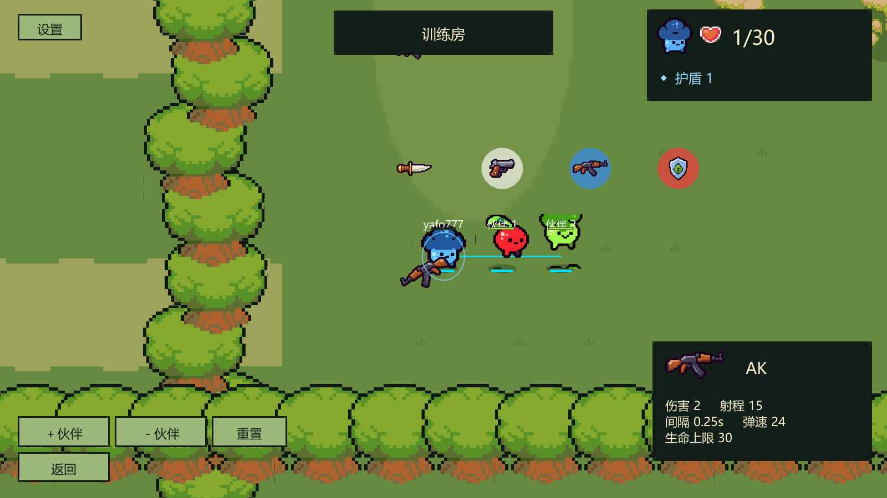

# 道具修改第4条：三级随机物资点

后续新增[三道具背包](ITEM_INVENTORY_E_CYCLE.md)：随机点产生的道具拾取后先入库、选中再使用；背包满时地面物资保留，不启动刷新计时。本篇概率和刷新时间继续有效。

2026-11-02，用户确认本篇概率、刷新机制及保留原布局的方案，授权与第3条友伤一起实现。只交付本地源码与测试，不构建、不打包、不部署、不自动提交/推送Git。

## 已确认的初始概率

| 物资 | 普通白色 | 中等蓝色 | 高级红色 |
|---|---:|---:|---:|
| 手枪 | 25% | 15% | 5% |
| 匕首 | 20% | 10% | 5% |
| AK | 10% | 25% | 30% |
| 狙击枪 | 5% | 15% | 30% |
| 血包 | 20% | 15% | 10% |
| 护盾 | 15% | 10% | 10% |
| 炸弹 | 5% | 10% | 10% |
| 冲刺、绳索收缩/延长、弹性强化 | 各0% | 各0% | 各0% |
| 默认刷新间隔 | 15秒 | 25秒 | 40秒 |

每个点开局随机生成一件物资；拾取后开始倒计时，到期重新抽取一件。未拾取时原物资一直保留，不堆积、不定时替换。训练重置与对局再战也会重新抽取。抽取由主机/服务器执行，内容及类型通过现有快照同步给客户端。

同类型共用概率和默认刷新间隔；每个点可以单独覆盖间隔。0秒表示开局出现一次、被拾取后不再刷新。概率池不包含问号盒，避免二次抽奖掩盖实际概率；其他七种道具都可以单独赋予权重。

## 如何配置概率

1. 停止Play，打开 **Bound Shoot → Level Editor 关卡编辑器**。
2. 展开顶部 **三级随机物资：概率与默认刷新**，再展开普通/中等/高级。
3. 修改“默认刷新秒数”和各物资“权重”。右侧显示换算后的百分比：`该项权重 / 本类型总权重 × 100%`。默认总权重100，所以初始权重就是百分比；无需手动保持总和100。
4. 点击 **保存概率池**。该按钮保存三类概率与默认时间；地图布局使用下面的独立按钮保存。

权重0表示不参与生成；拒绝负数、NaN、无穷、重复/缺失条目及全部为0的池。默认刷新范围0–3600秒，权重范围0–100000。已在道具配置中禁用的道具不能设置正权重。

## 如何放置物资点

1. 载入要编辑的地图，例如当前森林对局使用的地图。
2. 在物件面板选择 **普通物资点（白）/中等物资点（蓝）/高级物资点（红）**，在Scene中点击放置；可以移动、复制、删除、撤销。
3. 选中该物件，在Inspector调整“物资点类型”。默认使用所属类型的刷新时间；勾选 **单独设置刷新间隔** 后填写该点的秒数。
4. 点击 **检查关卡 → 保存到游戏配置**。若需要保留可继续编辑的Unity场景，再点击“保存编辑场景”。
5. 重新Play并进入这张地图对应的对局。地图坐标布局与概率配置各有自己的保存入口，修改两者时应分别保存。

Scene中的方形标记及名称按白/蓝/红显示。游戏中用对应颜色的圆形底标标识类型，物资图标保留原色；拾取后底标变淡，刷新后恢复。颜色不改变武器本身的伤害或稀有属性。

此次按确认方案**没有自动替换原地图的固定物资点**。原有固定武器、道具和旧随机刷新逻辑保留；只有新放置或手动改成三级类型的点才使用新概率池。训练房仍由独立训练布局生成，关卡编辑器保存的对战地图不会自动修改训练房。

## 保存与实现

新增 `GameConfig.supplyPools`，每类记录11项权重和默认时间；`PickupDefinition`记录类型以及是否覆盖时间。旧地图缺少新字段时按固定物资处理。关卡往返加载、复制、保存保留新字段。

概率保存会重新读取最新配置，保留地图、友伤和战斗数值；若概率池本身被其他窗口/程序改过，则拒绝覆盖并要求重新载入。校验成功后使用临时文件替换保存，失败不改写原文件。数值编辑器和关卡编辑器原有保存也保留新增概率池。

主要文件均位于 `unity-client/Assets/BoundShoot/`：

- `Scripts/Gameplay/SupplyPools.cs`：概率池定义、加权抽取、颜色与校验。
- `Scripts/Gameplay/MapContent.cs`：首次生成、按点时间刷新。
- `Scripts/Gameplay/BattleWorld.cs`：权威拾取、重置、快照与颜色底标。
- `Editor/SupplyPoolEditor.cs`：关卡编辑器中的概率面板与保存冲突检查。
- `Editor/LevelEditorWindow.cs`、`LevelLayoutInspectors.cs`、`LevelLayoutIO.cs`及`Scripts/Authoring/LevelPiece.cs`：放置、Inspector、保存/载入与场景标记。

## 验证记录

本轮使用Unity 2022.3.62f3、`logs/knockback/project`隔离副本，保持用户原Editor打开。最终 **67项EditMode、19项PlayMode全部通过，两个进程退出码均为0**。报告：[EditMode](validation/friendly-supplies/edit.xml)、[PlayMode](validation/friendly-supplies/play.xml)、[源码匹配清单](validation/friendly-supplies/manifest.json)。

- 友伤覆盖关闭/开启、枪口近距离、飞行子弹穿透/阻挡、匕首、炸弹、自伤排除、护盾、保护、误杀及战绩；原狙击物理击退、墙体、绳索回归继续通过。
- 物资覆盖三类概率区间和默认时间、首次抽取、拾取后刷新、不替换未拾取内容、单点覆盖/一次性、地图往返保存、非法概率与并发保存冲突、真实对局拾取与重置、快照类型及底标颜色/冷却变淡。
- `node tools/validate-content.mjs`及`git diff --check`通过；JSON语义比较确认原地图布局没有改变。
- 初次新增友伤测试的通用搬位函数把射手也当作同队伙伴重新搬位，造成三项用例未命中。修正测试站位并重跑全部PlayMode后通过；未修改命中规则来规避失败。

画面检查使用现有ForestReview流程的隔离副本变体，临时在训练运行时插入三种物资点；流程包含训练、房间、对战和结算，退出码0。1600×900截图已人工查看，白/蓝/红底标和物资图标清晰可辨。这个截图测试布局没有写回正式训练地图；截图中的生命1/30、护盾1也由旧画面脚本专门设置，出生数值仍为30。

未做跨机器联机和真人手感验收；本机现有网络回归包含多客户端流程，但不等同于新功能的跨机器网络专项验收。

后续用户已确认第5、6条规则，进度与验收说明见[有限弹药与返回主菜单](ITEM_CHANGE_05_AMMO_06_MAIN_MENU.md)。
