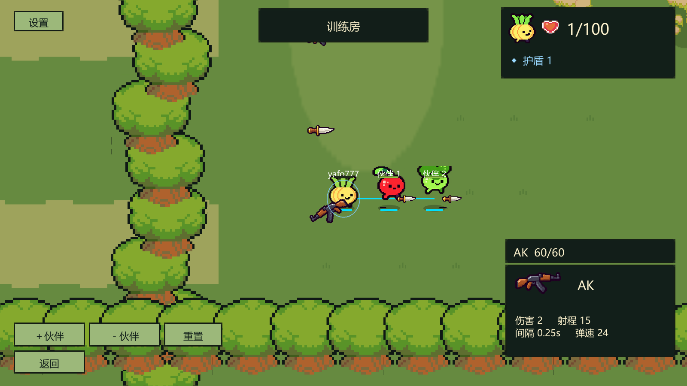
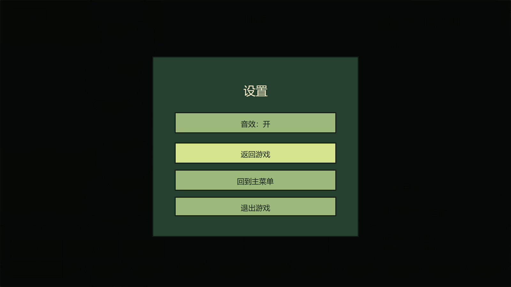

# 第5、6条：有限弹药、默认小刀与返回主菜单

后续道具交互已改为[三道具背包、E切换与左键使用](ITEM_INVENTORY_E_CYCLE.md)，原单个E道具条由四格栏取代。本文弹药、默认小刀与返回菜单规则继续有效。

2026-11-02用户确认本篇规则后实施。保留固定角色生命：当前配置100，换枪、弹药耗尽、切回小刀均不改变当前生命或生命上限。

## 第5条：有限弹药

| 武器 | 拾取时弹药 | 配置入口 |
|---|---:|---|
| 狙击枪 | 15发 | 数值编辑器 → 狙击枪 → 初始弹药（发） |
| 手枪 | 40发 | 数值编辑器 → 手枪 → 初始弹药（发） |
| AK | 60发 | 数值编辑器 → AK → 初始弹药（发） |
| 匕首/默认小刀 | 无限 | 不消耗弹药 |

- 初始小刀复用现有匕首及其伤害、射程和攻击间隔，不新增另一种刀。真人、AI、训练伙伴和靶子出生/复活/对局重置均携带匕首。
- 每次被权威端接受的枪械攻击扣1发；空枪、打墙、命中护盾或受保护目标都消耗。冷却未结束、倒地、非战斗阶段等被拒绝的攻击不扣弹药。
- 最后一发正常完成命中或生成弹丸，保持发射时枪械的伤害、弹速、射程和击退。随后枪械报废、不生成地面掉落，自动切回匕首，并保留必要攻击冷却。
- 没有换弹/备用弹药。踩到另一把枪直接换枪并获得满额弹药；踩到同款枪会补至满额，不叠加。已经满额时不消耗地面同款枪；已经持有匕首时不消耗地面匕首。
- 死亡清空枪械及剩余弹药，复活给默认匕首。旧枪弹药不会在换枪或复活后保留。
- AI持刀时优先寻找枪械，没有可用枪械时仍能接近敌人用刀攻击；友伤和固定生命规则继续生效。
- 右下增加持续显示的“武器名 当前/总弹药”，匕首显示“无限”，倒地显示横线。该行独立于3秒拾枪卡和E道具。补满同款枪也会重新显示3秒拾枪卡。

初始弹药可在 **Bound Shoot → 数值编辑器**修改，枪械允许1–9999发。停止Play后保存、重新Play生效；不热改当前对局。弹药由主机/服务器扣减，网络变量同步给客户端。

## 第6条：设置返回主菜单

在设置面板中新增 **回到主菜单**，位于“返回游戏”和“退出游戏”之间。返回的是“训练房／本地AI对战／联机对战”模式选择页。

- 训练：关闭训练会话、销毁对局对象，关闭设置面板。
- 本地AI或联机房主：结束自己主持的房间，断开房内客户端，再返回菜单。
- 联机客户端：退出当前连接，原房主和其余玩家可以继续；沿用现有离线席位处理。
- 连接过程中也可以返回；取消尚未完成的进入/轮询流程，避免稍后被旧回调拉回战斗界面。
- 保留玩家名字、角色选择及音效设置，清空当前对局/房间/结算状态和输入阻挡状态，可再次进入训练或创建房间。
- 旧在线账号流程会断开战斗与大厅连接；等待房尝试退房，并尝试注销会话。网络清理失败仍返回菜单并显示必要错误提示。此轮未访问或部署旧云端，不改变其战斗中禁止主动退房的既有后台规则。

## 实现位置

路径均相对 `unity-client/Assets/BoundShoot/`：

- `Scripts/Core/Models.cs`、`Resources/GameConfig.json`、`Editor/BalanceEditorWindow.cs`：弹药配置与校验。
- `Scripts/Gameplay/NetPlayer.cs`：网络弹药、装备版本、补满、出生复活默认刀。
- `Scripts/Gameplay/BattleWorld.cs`、`BotController.cs`：扣弹药、最后一发、自动回刀和AI寻找枪械。
- `Scripts/UI/ForestFlow.cs`、`WeaponPickupNotice.cs`：持续弹药HUD、同款枪拾取卡、设置按钮。
- `Scripts/UI/GameClient.cs`：统一返回菜单和会话清理。

## 验收步骤

1. 停止Play并等待编译；数值编辑器重新载入，确认枪械弹药15/40/60、角色生命100。
2. 进入训练，确认出生持刀、HUD显示“无限”。拾取三种枪分别检查剩余弹药；开枪、打墙、打靶都应扣1发。
3. 可临时将某枪初始弹药设为1，保存重进训练。打出最后一发应正常伤害/击退，随后持刀；检查血量没有因此变化。验收后恢复所需弹药数。
4. 消耗几发后再次踩同款枪，补到满额；满额不继续吃掉同款地面枪。等待3秒，拾枪卡隐藏但弹药行仍显示。
5. 训练、等待房、对战分别打开设置 → 回到主菜单，再重新进入。联机房主返回时，其他客户端应被断开；音效与角色选择保留。

## 验证记录

本轮在Unity 2022.3.62f3隔离副本运行，不关闭用户原Editor。最终 **68项EditMode、25项PlayMode全部通过，退出码均为0**。报告：[EditMode](validation/ammo-menu/edit.xml)、[PlayMode](validation/ammo-menu/play.xml)、[源码匹配清单](validation/ammo-menu/manifest.json)。

覆盖四武器默认装备/弹药、逐发扣减、拒绝攻击不扣弹药、同枪补满与不叠加、最后一发伤害/击退、攻击冷却、死亡/复活/重置、持续HUD和同款补弹提示；4/6/8客户端流程验证最后一发的弹药与切刀同步；训练返回/重新进入、等待房和战斗中房主退出与客户端断开、连接取消与偏好保留均通过。保留友伤、随机物资、固定生命、绳索与战斗表现回归。

首次回归的两个测试问题已修正：旧100弹丸压力用例加入按规则拾取补弹，保持原并发弹丸/射手归属检查；连接取消用例改用受控的静默UDP端点，避免连接未监听端口时的系统ICMP报错干扰取消流程。修正后完整PlayMode重跑通过，没有忽略错误日志。

`node tools/validate-content.mjs`、`git diff --check`通过。与本轮修改前的JSON比较，只有四种武器新增弹药容量，角色生命100、地图布置、物资概率及其他数值均保留。

截图流程正常退出0；已查看1600×900实机Editor画面，弹药行和设置四个按钮完整可见。截图专门设置了低血量用于展示，不代表出生生命。

未做跨机器联机或旧云端账号清理实测；网络验证为同机多客户端。仅交付源码与文档，不构建客户端/服务端、不打包、不部署、不自动提交或推送Git。
