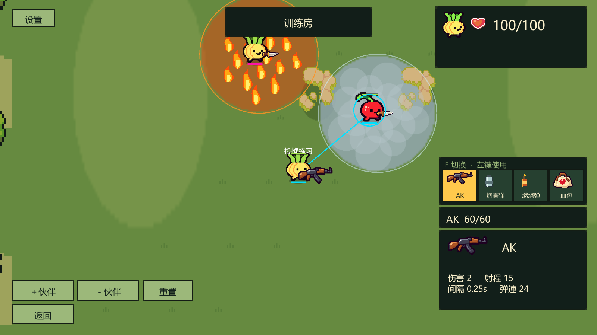
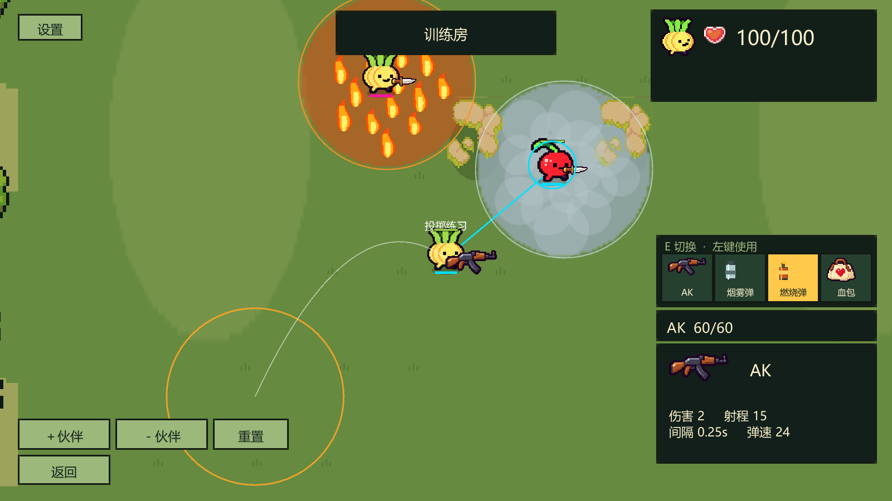

# 第7条：烟雾弹与燃烧弹

2026-11-02：按用户逐条确认后的方案实现。本条不包含尚未确认的第8条火箭炮。

## 操作与初始数值

两种新道具先进入现有三个道具格，每件占一格，可重复携带。E选中后显示落点圆圈与抛物线，朝鼠标方向左键投掷一次；消费后自动回武器位，须松开左键才能继续攻击。满背包保留地面物资。角色生命仍按当前配置100计算，与装备无关。

| 参数 | 烟雾弹 | 燃烧弹 |
|---|---:|---:|
| 固定投掷距离 | 8世界单位 | 8世界单位 |
| 飞行时间 | 0.65秒 | 0.65秒 |
| 区域半径 | 3 | 3 |
| 落地后持续时间 | 8秒 | 6秒 |
| 敌方伤害 | 无 | 每秒10点 |
| 自己及队友伤害 | 无 | 每秒2点 |

投掷方向由本次输入中的鼠标瞄准方向决定，鼠标远近不改变距离。抛物线越过中途障碍物，只有落点需要有效：落在墙体内部或地图边界外时，沿同一射线以0.05单位以内的步长向投掷者缩短，找到有效位置。投掷物落地前不会遮挡或伤人。飞出后即使投掷者死亡，区域仍正常存在至结束；训练重置、结算、再战和离开对局清空区域。

## 烟雾可见性

烟雾双向遮挡敌人：观察者与敌人之间的视线穿过任意有效烟雾圆，敌人的身体、武器、影子、名字、血条、护盾和近战挥击均隐藏。人在烟雾内同样不能看见外面的敌人。烟雾散去或绕开烟雾后恢复显示。

自己和队友仍显示角色及位置，位于烟雾中的友方额外显示轮廓圈，本人金色、队友蓝色。敌方绳索只要经过烟雾或有一部分被烟雾挡住，就整条隐藏，避免暴露角色位置。隐藏敌人的枪口闪光、受击反馈、拾取反馈和脚步粒子也受遮挡约束。

烟雾不阻挡移动、子弹或伤害，仍能盲射。AI挑选目标、追踪和开火时检查同一套烟雾视线规则，失去视野立即放弃原目标，不持续追踪隐藏位置。

实现范围是正常客户端的渲染遮挡与服务器AI视野；沿用现有网络位置同步，并未增加反作弊级别的逐客户端实体信息裁剪。

## 火焰伤害

燃烧区域按服务器物理步长累计伤害，敌方约每0.1秒扣1点，友方和自己约每0.5秒扣1点。离开区域即停止伤害，未满1点的累计余量清空。不同火区重叠取最高适用伤害，不叠加；敌我双方火区重叠时，对自己造成敌方火区的每秒10点。

火焰始终存在低额友伤，与全局友伤开关独立。普通枪械、匕首和原炸弹仍遵循原有友伤规则。伤害先扣护盾，出生保护期间不受伤且不累计待扣伤害。区域中心至角色之间的实墙会挡住火焰伤害。友伤及自伤不增加投掷者伤害/击杀统计；敌方伤害归投掷者。

## 获取与配置

- 训练房现在有4件武器、10类道具拾取物（含问号盒），总共14个固定点。烟雾弹、燃烧弹位于道具区第三排。
- 关卡编辑器物件面板增加烟雾弹和燃烧弹，可放置固定点；已有地图布置保留。
- 白、蓝、红三级物资池均增加两条权重为0的条目。问号盒随机池中两种新道具的权重也为0；修改权重后才会随机出现。
- Bound Shoot → 数值编辑器增加投掷距离、飞行时间、两种区域半径/持续时间及敌我燃烧伤害。停止Play后保存，重新进入生效。
- GameConfig.json对应字段：throwDistance、throwFlightSeconds、smokeRadius、smokeSeconds、fireRadius、fireSeconds、fireDamagePerSecond、fireFriendlyDamagePerSecond。区域持续时间以这些专用字段为准。

## 实现

ThrowableRules提供射线落点回退和圆形烟雾视线判断。BattleWorld.Throwables负责服务器投掷、落地/结束时间、火区伤害和烟雾规则；WorldSnapshot携带投掷起点、落点、服务器时间、半径与种类。客户端按服务器时间绘制飞行和区域，重连会随下一次世界快照补齐当前状态。

ThrowableVisuals绘制两种道具图标、抛物线、落点圆圈、烟雾/火焰及友方轮廓。NetPlayer/CyberPlayerView负责隐藏敌方所有角色渲染和名字；BattleWorld负责绳索及反馈遮挡。BotController共享可见性判断，并在目标位于有效投掷覆盖范围时使用携带的新道具。

## 验收步骤

1. 停止Play，等待编译，进入训练房。拾取烟雾弹和燃烧弹，确认进入道具格而非立即生效。
2. E切换到新道具，移动鼠标检查圆圈与抛物线；鼠标远近只影响方向。朝障碍物另一侧投掷，确认跨越后落地。
3. 在目标位置生成烟雾，检查敌人、名字、血条及敌方绳索隐藏，自己和队友仍可定位；对烟雾内盲射仍可命中。等8秒确认显示恢复。
4. 在火区内放置敌人、队友和自己，确认敌方每秒10点、队友与自己每秒2点；关闭全局友伤后仍生效。检查护盾、出生保护、移出火区和墙后免伤。
5. 重叠投掷两枚燃烧弹，确认伤害不翻倍；重置训练或结束对局，确认区域和预览清空。
6. 相同新版源码的联机参与端检查同一个落点、飞行时间、烟雾消失及火区伤害。

## 验证记录

Unity 2022.3.62f3隔离工程验证：**73项EditMode、35项PlayMode全部通过**。火焰图形调整后再次通过5项新道具独立PlayMode用例；实际画面截图流程退出0，已检查烟雾中队友可定位、敌方隐藏、背包图标及投掷预览。

- [EditMode报告](validation/throwables/edit.xml)、[完整PlayMode报告](validation/throwables/play.xml)、[最终新道具独立复核](validation/throwables/play-throwables.xml)。
- [源码与隔离副本匹配清单](validation/throwables/manifest.json)、[画面检查脚本](validation/throwables/ThrowableReview.cs.txt)。
- 新用例覆盖固定距离越障、非法落点回退、烟雾双向遮挡与到期、入库及单次使用、非叠加燃烧、敌我伤害、护盾/保护、墙体阻挡、AI失去目标、角色/名字/绳索隐藏及恢复、穿烟命中和预览切换。本机4/6/8客户端回归验证了新道具输入、消费与飞行/区域快照同步。
- 修正了旧训练测试中12个拾取物的断言（现在14个），并为新用例明确启用靶子碰撞体及创建测试相机，避免测试结果依赖其他用例先运行。
- 配置静态检查和git diff --check通过。未做跨机器联机实测，所有参与端需使用相同新版源码。

截图采用独立测试布置，固定角色与区域位置便于检查，不会改动正式地图或出生数值。

本轮仅本地源码、配置、文档与Unity测试；不构建、不打包、不部署、不提交或推送Git。
