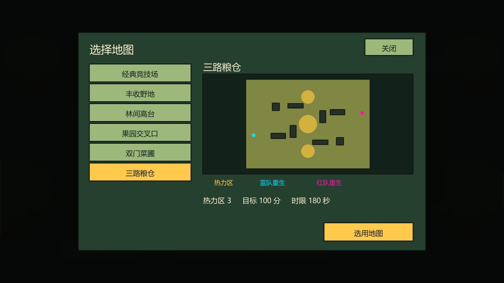
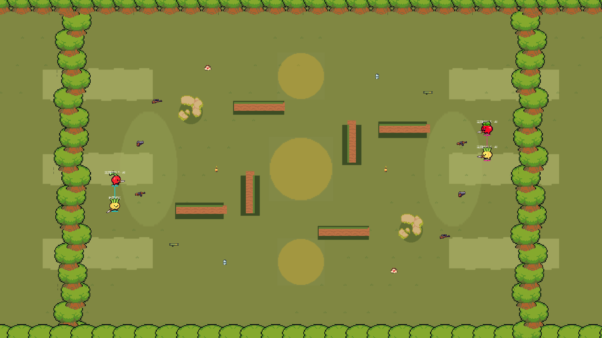

# 占点地图与对战选图

三张地图保留 180 秒和 100 分目标，并为双方提供镜像出生站位、武器补给和重生位置。各热力区独立抵消人数。

| 地图 | 热力区与倍率 | 对局设计 |
|---|---|---|
| 果园交叉口 | 中央一处，每净多一人每秒 1 分 | 从中央和两侧都能进点。错开的掩体提供绕行路线，也能把倒地队友拖回侧边救援。 |
| 双门菜圃 | 上下两处，各每秒 0.75 分 | 中央长墙隔开两个目标，队伍可集中拿下一点，也可沿墙两端调度，防止对手同时独占。 |
| 三路粮仓 | 中央主点每秒 1 分，上下侧点各 0.4 分 | 主点效率较高，侧点提供分兵机会。两侧各有一处火箭炮补给，可以隔掩体支援。 |

本地 AI 或局域网房间的房主在等待房点击「选择地图」，从列表查看地图平面预览、热力区数量、目标分和时限，再点击「选用地图」。金色为热力区，蓝红标记为各队重生锚点，深色矩形为掩体。房主确认后，其他玩家看到相同地图，原有座位与连接保留。重赛回到等待房后可以再次选图。

旧版账号联机等待房也使用同一个选图面板，后端从共享地图配置读取开放地图。部署到独立环境时，客户端、后端地图配置和战斗服务端需使用同一版本。

在 Unity 的「Bound Shoot → 关卡编辑器」可从地图列表载入三张地图，修改场地、物资、重生位置和热力区后保存到游戏配置。

Unity 隔离工程通过 76 项 EditMode 测试。PlayMode 完整回归通过 35 项，其中包含 4、6、8 个本机客户端的房主选图同步。另有一项旧计时断言因浮点误差触发，加入 1 毫秒容差后单独复跑通过。实际选图界面已截图检查，并通过该界面选用三路粮仓后进入对局。
