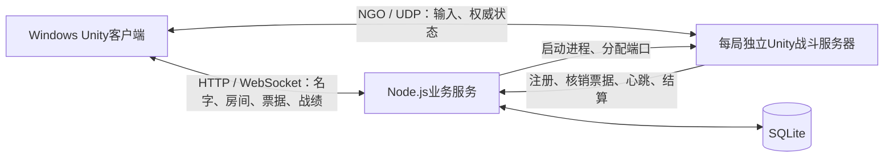

# 项目分析 · 2026-10-29

## 结论与范围

Bound Shoot 已具备可继续打磨的多人玩法原型：名字直进唯一2v2房间、真人替换AI、独立Unity服务器运行战斗、权威结算入库、返回原房间再战。当前最有价值的工作是验证和改善绳索协作手感、公网体验与异常恢复，而不是更换联网架构或继续扩充入口流程。

本次依据当前源码、配置、测试源码及仓库历史报告分析；只新增本文档，没有修改玩法、数值、地图或联网实现，没有构建、运行四客户端、连接或修改远端。分析时已有的 `unity-client/Packages/packages-lock.json` 修改予以保留。

这里的“已实现”表示有对应源码；“历史验证”表示仓库已有记录；本次实际执行的验证单独列出。不能把三者互相替代。

## 产品与核心玩法

- 当前有效需求为2026-10-28名字入口与AI补位；原始需求中的密码注册、建房、准备与六/八人模式不属于当前玩家入口。
- 核心区别在于同队绳索限制走位，队友死亡后尸体继续参与物理和绳索，存活者可拖尸体进入复活区。因此应围绕“共同走位、拉扯、救援”判断游戏是否有趣。
- 四种武器采用拾取后锁定至死亡的规则，武器同时决定最大生命；七种道具及问号盒影响绳长、弹性、生命、护盾、冲刺和爆炸。
- 当前配置为180秒回合、5秒复活、5单位基础绳长、30Hz物理、15Hz世界快照，开放一张 `Arena_01` 地图。武器数值属于现有设计，本次不据静态分析提出改值。
- AI承担补位与基础玩法验证：服务器内执行寻枪、绕障、追敌、攻击、救援目标选择及携带道具使用。是否能稳定完成复杂拖尸救援，仍需实战证据。

## 架构与职责

| 层次 | 当前实现 | 评价 |
|---|---|---|
| 客户端 | Unity 2022.3.62f3c1、NGO 1.8.1、Transport 1.4.0、运行时UI | 入口与战斗共用工程，正式客户端和QA驱动通过编译条件隔离 |
| 战斗服务 | Rigidbody2D、绳索、弹丸、伤害、AI、复活、胜负 | 权威归属清晰，客户端不能直接指定最终生命或位置 |
| 业务服务 | Node.js 24+、TypeScript、Express、WebSocket | 管理身份、房间、一次性票据、进程生命周期及结果 |
| 持久化 | Node内置SQLite、迁移、事务、唯一约束、WAL | 适合当前低人数原型；尚无规模化运行数据 |
| 内容 | Resources/GameConfig.json、关卡编辑场景、导出校验 | 策划可编辑关卡；三端内容一致性目前依赖交付流程 |

主要代码入口：

- 启动与模式选择：`unity-client/Assets/BoundShoot/Scripts/Core/Bootstrap.cs`。
- 名字入口、房间、战斗连接与结算UI：`unity-client/Assets/BoundShoot/Scripts/UI/GameClient.cs`。
- 服务器接入与结果提交：`unity-client/Assets/BoundShoot/Scripts/Networking/ServerRuntime.cs`。
- 战斗主循环：`unity-client/Assets/BoundShoot/Scripts/Gameplay/BattleWorld.cs`。
- 角色输入与状态：`unity-client/Assets/BoundShoot/Scripts/Gameplay/NetPlayer.cs`。
- 绳路与拉力：`unity-client/Assets/BoundShoot/Scripts/Gameplay/RopePath.cs`。
- 服务端AI：`unity-client/Assets/BoundShoot/Scripts/Gameplay/BotController.cs`。
- 房间与比赛生命周期：`backend/src/rooms.ts`、`backend/src/matches.ts`。

当前架构与既定NGO + Unity权威服务器 + Node业务服务方案吻合，没有发现需要为现阶段目标整体替换架构的依据。

## 已有工程价值

1. 接入不是单纯相信客户端身份：后端发短期一次性票据，Unity服务器核销后绑定固定队伍、座位与原实体。
2. 输入包含序号和epoch，检查有限向量，超时清空；断线保留实体，恢复连接时重新绑定所有权。这些机制为异常恢复提供了基础。
3. 战绩写入使用完整唯一名单校验和数据库事务，重复结算有幂等处理；异常中止不计正常胜负。
4. AI走实际移动、拾取、攻击和伤害逻辑，不依赖额外QA客户端替代服务器机器人。
5. 关卡编辑器包含导入导出、Undo、网格、出生点和碰撞校验；保存时重新加载数值配置，拒绝覆盖同图外部改动。这对多人协作比单纯摆放工具更有价值。

## 主要问题与优先级

### 优先处理：结算重试与后端超时存在冲突

源码依据：`ServerRuntime.cs:64`、`:75`、`:78`，`HttpApi.cs:19`，`backend/src/matches.ts:135`。

提交结果时设置 `finishing=true`，常规心跳随之停止；结果最多提交5次，每次HTTP超时12秒，失败后等待1秒。后端仍会把超过20秒没有心跳的Ready/Playing比赛置为Aborted。

因此，若结果请求连续延迟或失败，而后端仍在执行清理，重试尚未结束比赛就可能被中止；之后 `finish` 拒绝已中止比赛，正常完成的战斗可能无法入账。正常低延迟成功路径不受这一条件影响。本次为静态时序分析，尚未进行故障注入复现。

建议明确加入结算阶段与独立截止时间，或在结果被确认前保持匹配该状态的存活通知，并测试“提交延迟、响应丢失、重复提交、后端重启”分别如何收尾。

### 优先处理：三端配置没有显式版本握手

源码依据：`Models.cs:23`、`:66`，`Bootstrap.cs:20`，`BattleWorld.cs:34`。

客户端与Unity服务器各自读取打包的Resources配置；Node另从配置文件读取可用地图。连接协议传递mapId，但没有显式内容版本或GameConfig摘要校验。`ForceSamePrefabs`不能当作地图和武器JSON一致性的检查。

如果只更新关卡配置、只更新一端程序，可能出现显示布局与服务器碰撞不一致，或新地图在客户端不存在。现有文档已要求三端一起更新，但运行时尚不能明确拒绝不匹配版本。

建议在构建内容中生成版本/摘要，在开局和接入阶段检查一致性，并返回简短更新提示。关卡编辑器新增格式后尤其需要这一保障。

### 体验重点：本地角色尚无移动预测

源码依据：`NetPlayer.cs:49`至`:55`、`:74`，`SnapshotBuffer2D.cs`。

本地玩家也在收到服务器位置后进行平滑，没有按本地输入立即推进并按权威状态校正的完整预测逻辑。远端角色有带时间戳的插值和有限外推。

这能保证权威一致性，但公网延迟下，本地移动反馈会受到网络往返与平滑影响。尚无本次公网手感实测，不能据此量化延迟或认定体验不合格。

建议先记录不同网络条件下的RTT、输入到画面反馈、位置修正幅度，再实现本地移动预测与校正；射击延迟补偿需单独设计，不要与远端插值混为一项。

### 玩法重点：绳索是最短路径软约束

源码依据：`RopePath.cs:36`、`:51`及 `RopePhysics.Apply`。

当前用外扩矩形可见性图求最短折线路径，再沿路径端点施加弹性/阻尼力。它有真实物理拉力，但没有保存持续缠绕拓扑，近似等长绕柱路径可能切换；无可行路径时退回直线。

冲刺、尸体拖拽、窄道与多柱绕行是重点验收场景。地图编辑器允许的布局不等于AI与绳索已证明可稳定通过。优先验证2v2的典型地图交互，再扩六/八人链条。

### 网络扩展：高频世界状态采用完整JSON快照

源码依据：`BattleWorld.cs:189`至`:195`，`GameConfig.json`。

拾取物、弹丸、炸弹及绳路按配置15Hz序列化并广播完整JSON；文档记录为可靠RPC快照。快照中的弹丸按数组位置更新视图，没有稳定标识和连续插值。

四人原型可以先测量再优化；现在没有带宽或CPU基准，不能直接称为性能瓶颈。潜在问题是弹丸显示跳动、重复传输与丢包时的可靠消息积压。建议先增加可测的快照大小、每秒流量和服务器帧耗时记录，再按对象寿命和重要性拆分状态同步。

### 入口边界与工程维护

- 无密码名字身份是明确批准的调试设计，当前不验证名字所有权；不宜作为正式账号或长期竞技战绩的身份保障。正式账号发布时再落实已约定的HTTPS/WSS和身份策略。
- 唯一公共房间是有意设置的容量边界；第五名真人以及新玩家在战斗中等待属于当前规则，不应误报为匹配服务故障。
- `BattleWorld`同时处理战斗规则、快照及部分渲染，`GameClient`同时处理页面、请求与连接状态。代码体量仍小，但写法较密集。建议随改动逐步提取职责与明确状态类型，不做无目标的大重写。
- README记录旧电脑绝对路径及目录联接；当前检出的 `unity-client` 是普通目录。`tools/check-editor.ps1`默认Unity路径也属于旧机器。
- `ARCHITECTURE.md`末尾仍写“账号流量先通过SSH转发”和远端程序“将来”准备，与当前公网直连要求和后续交付记录不一致。
- `backend/package.json`版本为0.1.0，而health声明0.2.0。建议统一发布版本来源，避免用单一health字段判断三端是否一致。

## 验证证据与本次结果

| 项目 | 证据与结论 |
|---|---|
| 本次配置验证 | 使用本机Node v24.18.0执行 `node tools/validate-content.mjs`，通过武器、道具、地图及碰撞净空校验 |
| 当前测试源码 | 4个后端顶层集成测试；21个Unity EditMode测试方法，覆盖基础规则、快照和关卡编辑器 |
| 本次后端测试 | 未运行：检出时无node_modules；离线安装缺缓存，联网安装因 `registry.npmmirror.com` DNS解析失败而未完成。没有因此修改锁文件或依赖版本 |
| 本次Unity编译/测试 | 未运行；检查到本机Unity 2022.3.17f1，工程声明2022.3.62f3c1。本次没有尝试用不同版本打开或迁移项目 |
| 历史完整对局 | `acceptance-2026-10-28.json`记录1真人+3AI、2真人+2AI、4真人+0AI，各两局；四人组合包含180秒结算 |
| 历史证据边界 | 上述报告是本机Windows客户端连接WSL Linux服务器；报告的 `cloudMatchVerified` 为false。STATUS另记录用户反馈云端更新后可用，两种证据范围不同 |
| Unity历史报告差异 | STATUS记载最新21项通过；仓库 `docs/unity-tests.xml`仍为2026-10-27的8项通过。最新21项结果在本次检出中没有对应的同名XML可复核，不能用旧XML证明最新全部测试通过 |
| 当前构建产物 | 本次检出没有根目录builds或logs，README的exe路径及历史日志路径并非当前机器上现成可运行的交付物；这些目录被Git忽略 |

本次依赖安装尝试的临时缓存与新建的不完整node_modules在结束前清理。分析不等同于本次四客户端或云端验收。

## 建议的下一阶段

1. 修复结算状态和超时衔接，补故障注入验证；建立三端内容版本检查。
2. 在匹配Unity版本的环境重跑21项EditMode与4个后端测试，保存带提交版本的最新报告，统一文档中的入口、路径和版本信息。
3. 由用户组织跨电脑公网2v2，重点观察移动反馈、绕柱拉扯、拖尸复活、冲刺撞墙和20秒断线恢复；记录具体网络条件与复现步骤。
4. 根据实测数据优化本地预测、快照和绳索路径稳定性，再考虑更多地图与更大队伍。

美术继续保持已约定的暂停状态。游戏内只增加操作所需的反馈；开发说明、验证步骤和问题记录留在项目文档。
