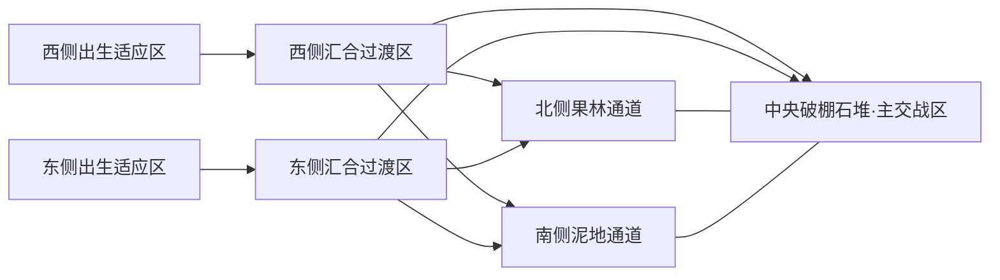

# Bound Shoot 全面升级策划指导：蔬果小队、大地图绳索对战

版本：设计稿 v1.1 · 2026-10-29，按用户最新说明修订。项目名仍为「派对射击 / Bound Shoot」；「蔬果小队」仅作本轮主题称呼。

**本版取代v1.0中的玩法扩展：玩法保持原队伍竞技，不做搜打撤，不增加战利品、撤离点、种子袋、仓库或带出结算。扩大地图的目的是让玩家先在外围适应绑定，再到中央开展对战。明确新增踩枪自动切换与八角色自由选择；默认2v2，最大4v4。**

**交付边界：本轮仅研究与策划，没有抠图、生成动作帧、替换素材、修改程序/数值/地图、构建或更新云端。下文所有新尺寸、节奏与规则都是待验证的建议，不是已经实现的功能。**

## 1. 这次升级要带来什么

一句话体验：每队2–4名被绳索串联的蔬果小人，扛着夸张的大枪，从各自草地出生区出发，先熟悉一起移动的牵制感、踩枪换装备，再向中央交战区汇合，按原有消灭/计时规则决出胜负。

三个核心：

1. **一眼记得住**：八个参考图角色保留各自的轮廓、脸和叶片；枪很大，但不能把脸挡住。
2. **先适应，再交战**：外围有宽路和简单绕障碍，中央有多入口掩体与枪械补给；通过空间布局引导节奏，不强制把开局切成不能战斗的教程阶段。
3. **每个动作都有回应**：小脚走动、叶片晃动、枪械后坐、命中、绳索拉紧和爆炸形成完整反馈链；热闹时仍看得清子弹、队友和障碍。

保留绳索作为主要特色。没有绳索也完全一样玩的关卡，需要重新设计。八个角色都可选择，默认2v2的四名玩家各自任选，最大4v4容纳八名玩家。八人不等于必须八种外观各占一个座位；本稿建议允许重复选角，以姓名/队标区分。角色只区别外观和表现，不新增八套技能、属性或不同碰撞尺寸。

## 2. 已有底子与本轮的设计缺口

以下依据当前源码与 GameConfig，而非旧截图或早期进度文档：

| 项目 | 目前基础 | 升级需要补的内容 |
|---|---|---|
| 战斗 | 四类武器；伤害、生命、道具、倒地复活 | 保留原有对战规则，明确允许踩到不同枪械时自动切换 |
| 绳索 | 持续绕障碍路径、弹簧/阻尼、队友/尸体牵制 | 大地图、树石密集区的长时间绕行验证及拉紧反馈 |
| 地图 | 默认竞技场 32×24 世界单位；矩形障碍/地面、拾取物、出生点/复活区编辑 | 更大地图的出生适应区、汇合路线与中央交战区，相机和自然地形接入 |
| 角色/人数 | 同一基础精灵配队色，skin 字段有基础结构；快捷房固定2v2 | 八个可选角色；默认2v2；4v4需要座位、选角、绳链、AI及结算一起验证 |
| 相机 | 启动时固定正交相机，orthographicSize=13.5 | 跟随本地玩家、有限瞄准前瞻、边界钳制、屏外队友提示 |
| 规则 | 2v2 消灭/计时结算；默认 180 秒 | 继续使用消灭/计时结算；不新增任何撤离/带出计分系统 |
| 训练 | 本地训练、静止队友、枪械道具、重置 | 自然风格测试区、动画与特效验证场景 |
| 发布 | 本地 Unity 测试可运行，不必每次部署云端 | 本地完整对局入口仍需后续单独落实；不能把训练房当完整对局验收 |

这次不是只换一张背景图。正式战斗拾枪后锁定武器是这次明确要取消的限制；道具的立即使用/单槽携带规则、倒地复活与胜负判定继续沿用。武器改变最大生命时如何处理当前生命，见5.3，防止换枪无意成为无限回血。

## 3. 研究参考：各学一件事

没有把网上评论或二手攻略当成开发者的内部策划案。本次使用官方商店介绍、官方画面入口和开发者公开制作讲座；下表的「应用」是本项目的设计推导，不是声称参考游戏内部就是这样实现的。

| 来源 | 可确认的参考内容 | 对 Bound Shoot 的应用 | 本轮不纳入的扩展 |
|---|---|---|---|
| [AK-xolotl 官方商店](https://store.steampowered.com/app/1479140/AKxolotl/?l=english) | 可爱角色持枪、俯视射击、武器与强化、多环境，官方页面提供画面 | 主要画面/战斗参考：圆角色和夸张枪轮廓、地面与主体对比、短促反馈；我们仍保持参考蔬果的像素形状 | 养成、烹饪、武器改造、大量新枪 |
| [Juicy Realm 官方商店](https://store.steampowered.com/app/732370/Juicy_Realm/?l=english) | 蔬果主题敌人、装备资源、随机区域、协作探索 | 主题参考：蔬果表情、田野分区和道具的幽默感；只抽象主题组织方法 | 它的具体角色、武器造型、手绘纹理和完整随机系统 |
| [Nuclear Throne 官方商店](https://store.steampowered.com/app/242680/Nuclear_Throne/?l=english) | 像素俯视射击与武器战斗 | 观察轮廓、弹道和打击层次；不照搬其密度来覆盖我们的绳索 | 不直接复制地图、代码、角色或音效 |
| [Jan Willem Nijman 的公开讲座入口](https://www.jwaaaap.com/) → The Art of Screenshake；[原视频](https://www.youtube.com/watch?v=AJdEqssNZ-U) | 作者页面列出该制作讲座，供后续观看逐项对照 | 制作方法参考：把射击反馈拆成可单独开关、比较的层；具体时长以我们的测试为准 | 不把「加震动」当作解决全部手感问题，也不由此改伤害数值 |

建议主要研究组合为：**AK-xolotl 的可爱大枪视觉 + 公开制作讲座的反馈分层方法 + 我们自己的绳索队伍竞技。** 先观察官方预告中的起步、一次开枪、命中、倒地、进入新区、拿到物品这六个时刻，逐个记录主体尺寸、颜色、持续时间与声音。前稿的Duckov撤离循环不再作为本项目玩法参考。

可以直接采用的是设计原则、经过验证的制作步骤，以及有明确兼容许可的通用资源。其他游戏截图仅作参考，不能直接剪成我们的资产；若后续找字体、音效或地块包，登记作者、原始页面、许可和署名要求。本轮没有下载第三方游戏资产或代码。

## 4. 八个角色：以这张图为身份基准

基准图：`example/images.jpg`，736×725 JPEG。SHA-256：`C28129859180DF039AA7A16CB4F6CA2F7628F0CAC8170E12911B5ECAF1E3A362`。

图中角色按「上排从左到右，再下排从左到右」编号；物种暂名仅用于沟通，不凭暂名改变原画。图中竹状植物和小草是环境参考，不计入八个角色。

| ID | 位置与暂名 | 必须锁住的识别点 | 走路可动部分 |
|---|---|---|---|
| VEG01 | 上排1，红色根茎小人 | 上方浅绿叶冠、棕红身体、小圆脸 | 叶冠延迟一帧，小脚交替 |
| VEG02 | 上排2，番茄/红果小人 | 顶部长弯绿梗、圆红身、横向脸 | 果身轻摆，长梗不能忽长忽短 |
| VEG03 | 上排3，西兰花小人 | 宽大深绿冠、浅绿小身、笑脸 | 冠部轻晃，始终保留上下两层形状 |
| VEG04 | 上排4，茄子小人 | 弯绿帽、长紫身、脸在下半部 | 轻点头，不能做成圆果 |
| VEG05 | 上排5，草莓小人 | 红色籽点、宽叶冠、夸张张嘴 | 嘴型/眨眼变化，籽点位置固定 |
| VEG06 | 下排1，洋葱/黄根茎小人 | 高叶束、淡黄圆身、竖向浅纹 | 叶束弹动、身体轻压缩 |
| VEG07 | 下排2，胡萝卜小人 | 橙色下尖身体、顶部两片深绿叶、表情 | 跺脚和叶片摆动，尖端轮廓不漂 |
| VEG08 | 下排3，蓝帽小人（物种待确认） | 深蓝圆顶、浅蓝下半身、帽上蓝高光 | 帽顶轻压缩；不擅自改成其他水果 |

### 4.1 抠图与「像素级」的实际处理

后续制作应先逐个抠出原图中八个静态角色，保留原始裁片备份；同名原图不能被覆盖。授权来源当前记为「用户提供，原作者/许可未核实」，开发样张按用户指定图处理，面向公开发行的素材清单补齐来源信息，不在当前策划阶段阻塞工作。

JPEG 有背景混色、缩放痕迹和边缘压缩，不是真正无损 Sprite。不能直接模糊选色删背景再缩小，或宣称抠出来就是原始逐像素素材。

1. 定位每个角色，分别划定身体、叶片、小脚和接地阴影。先做一张逐角色分层示意；阴影另存透明层。
2. 采用图像编辑生成透明裁片，检查深色描边没有被当成阴影删掉；检查叶片内孔、脸旁边缘和小脚之间的背景残色。
3. 以原图可见的阶梯边缘推断工作像素大小；初始建议使用 **48×48 逻辑画布** 容纳高叶片和西兰花宽冠，身体通常占20–30逻辑像素。最终值由第一名角色验收决定，不能直接把736像素截图尺寸当作游戏像素密度。
4. 在统一格点上整理色块，保留肉眼身份、轮廓、表情和颜色关系；若需要真正逐像素相同的原始颜色，必须获得原始PNG，JPEG无法恢复丢失的数据。
5. 输出透明PNG，Point采样、整数倍预览、无Mipmap、同一PPU和脚底枢轴；不使用双线性缩放补帧。
6. 八个角色保持天然体型差异，不靠给全部图片强行拉成同宽高来统一尺寸。所有帧放同尺寸画布，用脚底对齐。

可复刻的是这张图的身份和视觉规则：深紫灰1–2逻辑像素外轮廓、2–4个主色阶、顶左高光、短小脚、饱和果身、深色接地影；取消赛博朋克的金属板、霓虹框和发光面罩。

### 4.2 动画逐帧规格

先交付「八个原图静态身份片」；随后先用VEG07完成一套动画与持枪样板，通过后扩到八人。这样既不更换原图角色，也能避免八套同样的错帧。

正式首批每个角色制作34张独立帧，共272张；左向由右向镜像生成，不重复计入制作数量：

| 动作 | 方向/帧数 | 初始播放建议 | 验收重点 |
|---|---|---|---|
| 待机 | 正面、侧面、背面，各2帧，共6 | 2–3fps | 呼吸小、脚底不漂；冠/梗不换形 |
| 行走 | 正面、侧面、背面，各6帧，共18 | 8–10fps，随速度有限调节 | 接触→下压→经过→反脚接触→下压→经过；不是六张近乎相同的静态图 |
| 受伤 | 通用2帧 | 合计约80–120ms | 闭眼/挤压，配短闪，不遮住队色 |
| 倒地 | 通用4帧 | 约250–400ms后停最后帧 | 仍能认出身份；绳索仍连在逻辑身体上 |
| 复活 | 通用4帧 | 约300–500ms | 从倒地到站立连续，保护期不等于无敌长动画 |

身体逐帧与枪械程序后坐分开，不制作「8角色×4枪×全部方向×全部动作」的组合表。手/握持点做独立层，背向时枪放身体后方，面向时枪放前方；左右切向不把枪上下颠倒。允许小幅身体挤压，但脸和叶片尽量用真实帧表现，避免把硬像素整体拉伸成软胶。

八人基础碰撞共用当前标准体积；脚底为视觉锚点，碰撞中心按统一偏移映射。队伍通过脚下环/三角与绳色识别，不给整个蔬果染蓝或染红，不破坏原来的物种配色。队色再加形状差异，不能只靠红绿色区分。

## 5. 枪械与道具：保持四枪八物，完整换一套外观

### 5.1 大枪的比例与辨识

以角色「不含叶片的身体高度」为 H。建议：手枪长0.75–1.0H，AK长1.25–1.5H，狙击枪长1.6–1.9H，匕首长0.65–0.9H。枪高控制在0.25–0.45H，避免把番茄脸挡住。枪放大改变画面，不自动改变射程、伤害或碰撞。

| 武器 | 新外观方向 | 主要轮廓/声音/动作 | 需要守住的规则 |
|---|---|---|---|
| 手枪 | 短粗野营手枪，木柄、蓝灰铁件、暖色小扣 | 短枪管，大扳机，轻脆单发，短后坐 | 仍是手枪角色，不额外加散弹机制 |
| AK | 旧农场步枪，粗弯弹匣、木托、少量浅绿绑带 | 弹匣辨识，连续轻后坐，壳落地 | 沿用AK数值和射击方式 |
| 狙击枪 | 长管观察镜步枪，暖木托、深灰长管 | 镜筒、长管，较大一次后坐，短烟尾 | 当前range=100在大图上可能跨多屏，必须测长视线；不能用视觉缩短伪装数值问题 |
| 匕首 | 小园艺刀/收割刀造型，厚刀刃与木柄 | 扇形挥击、少量草叶，靠近才命中 | 仍是匕首；挥击图形不暗示超出真实伤害范围 |

每枪交付：独立持有Sprite、地面拾取Sprite、HUD图标、枪口点、握持点、后坐配置与发射特效。金属用同一深色描边和少量平涂色阶，不沿用赛博霓虹枪。

大枪会伸出角色碰撞体：后续实现必须检查枪口到目标的墙体遮挡，尤其贴墙枪口在墙另一侧时不能从错误位置发弹；首版不因大枪引入可钻墙的逻辑枪管。

### 5.2 八种道具全量表

| 道具 | 自然像素图案 | 取得/使用反馈 | 规则维持 |
|---|---|---|---|
| 绳索收缩 | 绳结、向内双箭头、短线轴 | 敌队绳上一次向内脉冲，状态图标有时长 | 拾取立即生效，对方队伍变短 |
| 绳索延长 | 展开的线轴、向外双箭头 | 本队绳上一次向外脉冲 | 拾取立即生效，己方变长 |
| 护盾 | 小木盾/叶片盾徽，轮廓清楚 | 小盾环出现一次，受击破碎碎片 | 取得1点盾；上限仍用配置 |
| 冲刺装置 | 绑带靴与短风线 | 放入携带格；E后叶片/尘点残影 | 只存一件使用道具，一次冲刺 |
| 炸弹 | 暖灰圆炸弹，短引线 | 携带→放置→闪烁加快→爆炸 | E放置，3秒引线；范围提示与真实半径一致 |
| 弹性强化 | 黄绿弹簧夹在两段麻绳间 | 绳节点短暂弹动，HUD弹簧标记 | 双方增强弹性/回拉，倍率沿用x3 |
| 血包 | 米白布包与红心/小叶标 | 少量绿十字/叶点向上，血格回弹 | 立即回血1点，不突破上限 |
| 问号盒 | 木质菜筐盖板上一个大问号 | 短开盒/弹出反馈，立刻落到结果图标 | 沿用随机道具池，结果只计算一次 |

状态道具和携带道具在底座上用不同形状区分，避免靠长说明理解。携带格新物覆盖旧物时做一次图标滑入/替换声，不增加确认弹窗。无需给每类道具都套巨大光柱。

### 5.3 踩枪自动切换：适用于正式对战与训练

确定行为：活着的角色接触到地上的不同武器，立即切换为该武器，不按键、不弹确认、不要求先死掉。仍只装备一把；角色外观选择与武器种类互不绑定。

后续实现建议按以下边界执行，避免把自由换枪变成漏洞：

- 切换成功后消耗该地面拾取物，按原刷新配置重生；原来手中的武器不自动变成一件地面复制品。若要「旧枪交换到脚下」以后另提，当前不增加。
- 踩到同一种枪时不重复切换、不回血、不重复播特效、不消耗该枪；离开再踩仍按正常拾取判定。
- 倒地角色不能换枪。多个角色同一物理帧踩到同一件，只能有一人拾取，按距离优先、相同距离按稳定玩家ID决定，结果只算一次。
- 枪械刷新在角色脚下时按同样规则处理；武器点之间避免重叠，多个点同时覆盖时先选距离最近的一件，每物理帧只处理一次武器切换。
- 保留各枪最大生命配置，**建议换枪后当前生命=min(换枪前当前生命,新最大生命)**，不按Equip的旧行为回满。例：AK剩2/3→狙击为1/1→切回AK为1/3。血包和复活仍负责回血，护盾独立保留。此生命处理为防漏洞的策划建议，交实现前需与数值同学对齐。
- 枪的攻击冷却不因换枪清零。建议下一次允许攻击时间至少不早于原冷却结束，并满足新枪切入冷却，避免用交替踩枪绕过狙击攻速。
- 旧枪已发出的子弹按发射时的数据处理，不因换枪改伤害/归属。新枪只影响之后的攻击和显示。
- 用一次短持枪变化、HUD图标更新和拾取音反馈切换；不能靠弹长提示说明发生了什么。

当前训练分支已有换枪便利逻辑，但正式战斗仍有锁枪规则。本轮只更新规格，后续需统一这两条路径与相关测试；不宣称代码已经改好。

## 6. 大地图：外围适应绑定，中央开展对战

### 6.1 尺度与相机

现有图32×24=768平方单位。建议第一版自然地图 **80×64=5120平方单位，面积约6.7倍**；这只是布局试验起点，不是为了追求面积越大越好。工作图世界中心(0,0)，x∈[-40,40]、y∈[-32,32]；如果2v2空跑过长，优先减少支路纵深与调整掩体，不把角色缩小到看不清。

现有移动速度5单位/秒，裸直线横穿80单位约16秒，单边出生点到中央约6秒。通过起步换枪、简单绕障碍和间接路径让玩家获得约8–15秒的协同移动体验，目标首次正式接战约15–25秒；这些是试玩目标，不靠强制禁战或假装地图天然就要走一分钟来保证。

地图变大后相机跟随本地玩家，少量鼠标方向前瞻、边界钳制；不能把整图缩进同一个屏幕。首版建议视窗约30×17单位，结合工作像素格、PPU和整数放大验证，保持角色、枪、绳和下一块掩体清晰。屏外队友有方向箭头、头像和张力提示，敌人不显示屏外位置。

4v4时相机仍以自己的角色为主，不为同时塞下四个队友无限拉远；分辨率和长宽比不能无条件提供更远的射击视野。命中停顿/震动只作用于本地表现，不改全局Time.timeScale。

### 6.2 布局采用三段节奏，不采用三种新规则

**出生适应区 → 汇合过渡区 → 中央交战区** 是空间分区。玩家从开局就可按原规则移动、开火、拾取、复活；没有必须完成的教程任务、保护闸门或等待敌人的强制阶段。利用视线遮挡、枪械位置和路口引导自然汇合，也允许主动早推或侧绕。

| 分区 | 初始布局建议 | 玩家应自然学到什么 | 不应发生什么 |
|---|---|---|---|
| 两侧出生适应区 | 西(-32,0)、东(32,0)附近；宽空地，基础枪，1–2个大间距软拐点 | 两个人一起出发、谁先走、绳长有限、踩枪切换 | 刚出生就吃跨图狙击；窄缝卡死；没有可用枪 |
| 汇合过渡区 | x约±12至±24；上中下三路连接；各一路简单石堆绕行与另一条宽绕路 | 绳索卡角、停下来等队友、改走外侧、换另一把枪 | 强迫所有人过同一狭口；整个四人绳链陷入迷宫 |
| 中央交战区 | x约[-12,12]、y约[-12,12]；石棚/土堆为主掩体，多个入口 | 掩护队友、拉扯绕后、争取换枪位置、救人/拖尸 | 唯一入口、高密树冠遮人、一个枪点覆盖全图 |

复活区沿用原规则，建议在两侧过渡区各设一个、到中央步行成本接近；两队都能到达且都有绕行路线。不能在适应区塞无限无风险回血，也不能把某队唯一复活点放在对方出生出口。

### 6.3 第一张图「丰收野地」

草地约占可见地面70%，土路/耕地约30%，仅是初始构图比例。用低对比大色块，少量小草与车辙说明方向；不逐像素铺满噪声。

| 区域 | 建议中心 | 功能与视觉 |
|---|---|---|
| 西侧菜地出生 | (-32,0) | A队起步、初始枪，两条宽出口；预留4个座位出生点 |
| 东侧树篱出生 | (32,0) | B队起步，装备可达性与A一致；同样预留4个出生点 |
| 北侧果林通道 | (0,18) | 两段稀疏树干和弯土路，中央侧入口；控制绕路长度 |
| 中央破棚/石堆 | (0,0) | 主交战区，多方向掩体与不同武器点，打破狙击长直线 |
| 南侧泥地/车辙 | (0,-18) | 稍开阔的侧绕路线，地面纹理变化，首版不默认减速 |
| 西/东过渡石场 | (-18,0)/(18,0) | 适应绳索绕角、停步等队友，通向中央或支路 |
| 南北边缘田埂 | (0,±27) | 边界地标与短连接，避免形成和中央无关的长空跑支线 |



固定布局先验收，不做无限地图或运行时生成地形。地图大的是可移动空间与路线选择，中央仍是主要对战场；不能把初始武器、所有补给、复活点和敌人全部放到彼此无关的四角。

### 6.4 2v2与4v4的场地适配

- 默认2v2，每队一条绳，共两条绳。最大4v4，每队按座位1→2→3→4串联，为三段绳，全场六段；不改为四个人两两全连接，也不把两队连在一起。
- 各段沿用基础绳长及已有增益规则。每段5单位不等于队长能单独控制整条15单位长绳；测试重点是中间两人受到两侧拉力与尸体拖拽。
- 八角色是可选角色库，和房间总人数分别管理；2v2可选任意四人组合，4v4可容纳八名玩家，重复选择默认允许。没有「选满八种才可开始」的门槛。
- 相同地图先做2v2布局与4v4布局预设，复用地形视觉。4v4扩大中央路口、增加两侧等价枪点并放宽出生间距，不必自动再翻倍整图面积。
- 主路建议3–5单位宽，4v4关键路口建议4–6单位；狭路不小于2.2单位，保留一条更宽绕行路。两人串行能过不能证明四人绳链和拖尸也能过。
- 开局枪点建议每名玩家至少有一件近处可拿的枪：2v2两侧各不少于2件、4v4各不少于4件；保持到达时间对称，不强制八人抢四把枪。
- 全图初始约12–16个枪械/道具点，4v4可试16–24个并分散在过渡区与中央侧面。仍使用现有刷新规则，不新增战利品资源或计分物。
- 目标初始拿枪≤5秒、协同起步约8–15秒、首次接战15–25秒；2v2任何一次连续45秒无接战且无队伍协同行为应复查路线。4v4重点记录拥堵与武器点串踩抢占。
- 开局出生出口遮挡跨图射线；中央不同枪型的换枪点要形成位置选择，而不是一个可被远距离狙击持续封死的孤立点。

### 6.5 障碍与绳索使用一致的世界

| 部件 | 角色 | 子弹 | 绳索 | 美术要求 |
|---|---|---|---|---|
| 草、花、碎叶、浅车辙 | 不挡 | 不挡 | 不挡 | 低对比，不能像硬墙 |
| 石块/有高度土堆 | 阻挡 | 阻挡 | 绕行 | 清楚接地边界；首版保守矩形逻辑掩体与外形吻合 |
| 树干 | 阻挡 | 阻挡 | 绕行 | 只碰树干，不按整个树冠碰撞 |
| 树冠 | 不新增碰撞 | 不新增碰撞 | 不新增碰撞 | 遮到角色/绳时淡化，和树干分层 |
| 小土包地面纹理 | 不挡 | 不挡 | 不挡 | 不能与高土堆共用完全相同轮廓 |
| 木栅栏/木箱 | 首版全挡 | 首版全挡 | 绕行 | 可破坏与穿透机制以后另提 |

现有编辑器只支持轴对齐矩形障碍。圆/多边形碰撞需同时升级物理、绳索、AI导航和编辑器；不能只改Collider，留下四套不一致的地图。以当前0.84角色直径、5单位基础绳长作测量起点；绳索拐点贴实际接地障碍，不沿树冠绕行。

### 6.6 保持既有胜负和道具逻辑

继续按对方全倒地/现有计时结果决定胜负，180秒为基线。大图如导致一局大量时间消耗在跑图，先改出生到中央的路线、枪点和相机，不自动改成长局。

状态道具拾到立即使用；冲刺与炸弹占同一个E槽，新使用道具覆盖旧的；护盾、回血、绳长与弹性增益沿用既有规则。局中角色外观不能换成新角色绕过死亡或清状态。结算仍展示队伍胜负和击杀/死亡等原统计，没有收获分、成功撤离人数或带出收益。


## 7. 特效和动效：做反馈链，不只堆粒子

以下时间/数量是初调范围，设计同学可修改。所有命中、爆炸、拾取与状态的实际结果由模拟端产生；客户端只播放表现，本地与未来云端复用事件规则。

| 事件 | 必有反馈层 | 首轮时长/强度建议 | 需要避免 |
|---|---|---|---|
| 行走 | 6帧步态、叶片轻摆、接地影；土地尘点或草地碎叶 | 每0.18–0.3秒最多一个脚步效果，按材质换色 | 每帧生成粒子、绿色角色消失在饱和草里 |
| 手枪发射 | 枪后坐、1–2帧闪光、短弹道、清脆声 | 闪光约40–70ms，后坐60–100ms | 所有武器用同一巨闪光 |
| AK发射 | 轻后坐、2种闪光交替、少量弹壳、持续节奏 | 单次幅度小；弹壳限量并复用 | 每颗子弹都强震、地面堆几百弹壳 |
| 狙击发射 | 一次强后坐、短烟尾、清楚高速弹道、低频声 | 后坐约120–180ms；短小镜头推力 | 大图中从屏外无提示打人；全屏长白闪 |
| 命中石/木/土 | 分材质碎屑、短命中光点、对应短声 | 80–160ms，2–5颗碎屑 | 击墙反馈和打中角色完全相同 |
| 命中角色 | 单次亮边/短闪、2帧挤压、局部果汁点、血格反馈 | 闪约40–70ms；果汁不覆盖子弹 | 用全局暂停影响联机时间；大范围红雾 |
| 受伤倒地 | 4帧倒地、掉落短反弹、表情变化、绳索仍连 | 250–400ms | 直接消失，导致队友不知道该拖哪里 |
| 炸弹 | 放置小弹跳、引线、可读半径圈、逐渐急促闪烁、5–6帧爆炸、尘环 | 3秒预警，爆炸主要可见约200–350ms | 首帧没有预警就爆；视觉范围大于真实范围 |
| 冲刺 | 起步挤压、2–3个低透明残影、方向尘点、收尾 | 沿用0.18秒动作，残影快速散去 | 冲刺效果穿墙看起来像可穿墙技能 |
| 治疗/护盾 | 正向轻弹、短图标、恢复/碎盾专属声 | 150–350ms | 每次治疗触发长特写 |
| 绳索紧绷 | 暗色外缘、张力点、一次绷紧声；恢复松弛时退回 | 脉冲去抖，不能每帧触发音效 | 张力反馈变成真实路径抖动；美术线偏离碰撞线 |
| 绳索增益 | 收缩向内、延长向外、弹性弹簧节点 | 开始一次明显反馈，持续阶段低强度 | 用波浪把真实绳索画到墙里 |
| 开盒/拾取 | 物体上提、图标向HUD飞、短声音 | 150–250ms | 状态/携带结果不明确，重复拾取计算 |
| 环境 | 树叶2–3帧、少量漂叶、草轻动 | 只近景少量可见对象 | 把整张地图每棵草都做Animator |

镜头震动建议默认低强度并可关闭，受伤/爆炸优先于普通连发。像素画面用整数逻辑像素位移，不能抖成持续糊边。碰撞后退、屏幕震动、枪后坐三者分开：美术后坐不能偷偷移动权威身体；真实击退另行作为数值/机制提案。

声音首版至少覆盖四武器发射、三材质命中、脚步两材质、拾取两类、绳索绷紧、炸弹引线/爆炸、倒地/复活、按钮。没有专职音频也不能忽略这一半反馈；选许可明确的资源或后续单独生成，并记录来源。每类限制同屏发声数量，远处战斗只给方向/距离感，不泄漏准确敌人坐标。

## 8. UI 与操作的改版范围

名字入口后加入八角色选择：小头像、名字、待机/短走路预览。默认2v2的四名玩家各自任选八角色，最多4v4八名玩家；本稿默认允许重复角色，不锁他人角色、不要求八种全满，用姓名和队标区分。每名玩家保留自己的选择，开局名单携带0–7外观ID，训练、AI、战斗显示、重连和结算读取同一映射。既有四外观范围不能直接冒充八角色支持。

房间人数与角色库分开：默认2v2，4v4为后续可选配置；当前快捷公共房固定2v2，虽通用房间有每队4席基础，仍需验证开放入口、完整八人名单、每队三段绳与八人结算，不称为当前已可用。保留训练房、本地完整对战（待实现）、云端验收短入口，不显示部署说明。

战斗HUD：生命、盾、当前武器、单个E槽、绳索增益时长、原有队伍存活/时间信息；大图增加小型方向图和屏外队友提示，4v4中可识别三个队友。踩枪自动切换时更新当前枪图标，无额外切枪按钮或确认框。

画面采用米白/暖棕木牌、绿叶装饰、深色像素边缘。文字使用可读中文字体，不强求所有中文都做手画像素字。必须能区分正常、悬停、按下、禁用和当前选中；没有正文长说明。必要的首次操作提示最多一行，可关闭；开发与测试说明继续只放Markdown。

## 9. 素材生产与交付约定

### 9.1 文件与分层

未来建议资源目录，不在本轮创建Assets：

```text
Art/Characters/VEG01..VEG08/  # source-cutout、idle、walk、hurt、down、revive、portrait
Art/Weapons/                # sniper、pistol、ak、dagger + anchors
Art/Items/                  # 八种icon、pickup、activate
Art/Environment/            # grass、dirt、transitions、rocks、mounds、trees、fences
Art/VFX/                    # muzzle、hit、explosion、dash、rope、status
Art/UI/                     # buttons、panels、HUD、avatars
Art/Audio/                  # 来源与许可单独登记
```

文件例：`VEG07_walk_side_f00.png` 到 `f05.png`；命名、画布、枢轴、PPU、默认朝向和武器锚点写到每批清单。透明素材不带文字、棋盘底、物品名称或固定大阴影；演示板另放工程外。草地边缘交付拼接Tiles，不给设计同学一张不可拆的巨型地面图。

### 9.2 素材数量基线

| 交付包 | 第一版数量/范围 | 完成标志 |
|---|---|---|
| 身份 | 8个原图裁片＋8个整理后的正面角色＋8头像 | 角色身份与原图一致；不是重新随机画8种蔬果 |
| 角色动画 | 8×34=272独立帧，左向镜像不重复计数 | 真正播放检查，无跳脸/错脚/脚底漂移 |
| 武器 | 4持有＋4拾取＋4HUD，4套锚点 | 四枪无文字也能认；贴墙开火正确 |
| 道具 | 8拾取＋8HUD；激活效果复用VFX | 八种都齐，收缩/延长无歧义 |
| 地面 | 草/土各4基础变体；至少16组合的草土边缘规则及转角 | 2×2测试块与长路拼接无明显接缝 |
| 障碍/装饰 | 石3、土堆3、树3（各拆干冠）、栅栏直/角/端、木箱2、草簇4 | 外观可走/不可走含义明确，设计同学能复用摆放 |
| 功能点 | 枪械/道具补给、出生与复活点基础表现 | 不把复活和护盾再用同一图案混淆，不制作撤离或种子袋 |
| VFX | 至少4种武器反馈、3种材质命中、爆炸、冲刺、治疗、盾、3种绳状态 | 有触发/结束事件、时长、容量与声音配置 |
| UI | 名字、八角色选角、2v2/4v4房间信息、HUD、结算 | 中文可读、必要标签齐全、可缩放，八人名字不重叠 |

### 9.3 AI 工作流

1. 原图身份裁片先过审；同一角色裁片作为后续所有动作参考，不仅在提示词写「胡萝卜」。
2. 一次只生成一种角色的一种动作/方向，附上身份与已验收帧；不把全部272帧一次交给模型。
3. 每组六帧先切开逐帧看，再在循环中看；对差帧单独编辑，保留好帧。不能把「模型返回六个小人」等同于可用走路动画。
4. 对齐脚底和画布，不逐帧按内容紧裁再动态缩放。阴影与枪械分层，避免不同枪需要重新生成角色。
5. 用统一色板/像素格检查AI输出，处理背景边缘与虚假透明。每次生成记录参考、提示词、输出、失败原因与修改；未验收资源标为draft。
6. 先在同一验证场景对比八角色、四枪、草土、石树、绳索与特效，再整图制作。正式接入前确保可替换回旧素材，旧赛博资源保留存档，不直接删除。

## 10. 同伴协作与实施顺序

设计同学继续负责出生适应区、汇合路线、中央交战区、枪点、枪械数值与节奏；程序/美术侧负责八角色选择、踩枪切换、素材规范、动画、相机、显示层级、事件特效及工具扩展。双方共享一张「资产ID—Prefab—碰撞类别—数值ID」映射表，避免设计同学摆石头而程序仍按另一块矩形判断。

| 阶段 | 实际交付 | 进入下一阶段的条件 |
|---|---|---|
| M0 视觉规范 | 8身份裁片、VEG07完整走路、大手枪、草土与一石一树组合样板 | 原图身份和像素尺寸稳定；小人拿枪脸仍可读 |
| M1 八角色与切枪反馈 | 八套34帧、四枪八物、八选角、正式/训练统一踩枪换枪、完整基础反馈 | 任选四角色与重复选角正确；换枪不无限回血、不重置攻速；无绳索回归 |
| M2 自然大图2v2 | 80×64试验图、出生适应/汇合/中央交战分区、跟随相机、自然障碍编辑接入 | 四人本地完整竞技能结算；先适应绑定再中央接战，无长空跑 |
| M3 4v4扩展验收 | 最多八人、自由选角、4v4布局预设、每队三段绳、AI与完整名单结算 | 八人均可玩；六段绳不穿模；中间玩家受双向力仍可移动；名字/队友提示清楚 |
| M4 集中云端验收 | 验证通过的客户端/权威服务器统一版本、一次部署 | 本地验证无阻塞缺陷，用户选择阶段发布 |

M0–M4是依赖顺序，不是承诺按天完成。资源数量大，先做一个可玩的高质量局部再扩展；动画身份/帧一致性可能需要多轮修图。训练入口适合日常美术验证，四客户端完整2v2与八客户端4v4分别用于规则验收；资源不足时可先分阶段模拟，但最后不能只测四人就宣称八人通过。云端保持现状直到阶段发布，不能边做一帧图边部署。

地图编辑器后续需要的工具扩展：资源类型/视觉ID、碰撞类型、装饰层、树干/树冠分离、批量刷草土与栅栏、2v2/4v4布局预设、每队4个出生点及武器点重叠检查。当前工具没有的内容都列为待开发，不新增撤离或战利品编辑类型。

## 11. 明确的验收与调试场景

**角色/美术**：八角色以实际屏幕尺寸站在草地、土路、石堆旁都能区分；脸不被枪遮住；左右/上下换向不翻脸；待机→走路→受伤→倒地→复活无脚底跳动；角色固有颜色不因队伍失真。

**枪械/反馈**：不开声音也能看出开枪/命中/受伤，闭眼听短录音能区分四武器；爆炸半径与伤害一致；绳索拉紧提示不改变路线；屏外爆炸不强震本地屏幕；特效结束会回收。

**地图/物理**：土堆正反两侧、石堆双拐角、树干绕一圈、窄路拖尸、冲刺卡角、绳索收缩/延长/弹性组合均不穿模；装饰草不绊人，树冠下仍能看到本地角色和绳；大枪贴墙不能隔墙发射。

**节奏**：至少5局本地完整2v2和3局4v4，记录拿枪、首个绳索绕角、进入中央、首次接战、最长空跑、中央拥堵与平均局时。建议拿枪≤5秒，协同起步8–15秒，首次接战15–25秒；以实际记录校准，不强制玩家等计时。4v4至少验收三名队友分布、出生抢枪、三段绳卡角与中间玩家倒地拖拽。

**选角与换枪**：八种逐个选择、跨队重复选择、同队重复选择、开局名单/重连/结算一致；满员2v2与4v4均正确。踩不同枪自动切换、同枪不重复消费、倒地不能捡、双人同时踩只成功一次、刷新在脚下、重叠点只切一次；生命和护盾处理正确、换枪不能绕过攻速，已经发出的子弹不改伤害。

**性能**：本机开发电脑先固定1280×720/1080p记录CPU/GPU帧耗；目标60fps即16.7ms预算是本项目目标，不是已达成结果。初始建议同屏短粒子≤200、弹壳/贴花≤40、普通短音同类≤4同时发声，再按Profiler调整。八套动画尽量图集化，装饰/特效对象池，禁止每帧生成整屏对象。

## 12. 本稿结论与待决项

已经明确的方向：原图八蔬果可选、默认2v2/最多4v4、踩枪自动切换、统一粗像素和大枪、草土田野与自然障碍、外围适应绑定后中央对战、更多动作反馈。玩法仍为原队伍竞技；旧赛博风退出主视觉方向，旧文件留档。

仍需后续样板/试玩决定：部分物种正式名、工作像素格、地图最终尺寸、4v4路口宽度和物品点位、换枪当前生命的建议处理与数值同学对齐、素材原始来源。允许重复选角是本稿默认建议，不要求8种互斥；若用户后续指定互斥再调整。不存在待定的搜打撤方向。

**推荐下一步执行M0：八角色静态抠图＋一个角色完整动作＋一枪一石一树一块草土的组合预览。** 样板确认后做八选角、统一自由换枪与完整反馈，再验收大图2v2、最多八人4v4，阶段完成后集中云端发布。
